## TL;DR

- **问题与定位 ·** 原生 NVFP4 RL 可能在训练后期失稳。我们从量化、激活缩放、KV 缓存和执行路径排查误差，再分析误差如何影响更新。
- **算法与工程 ·** TRIAGE 从更新方向控制残余失配风险；miniTE 从数值执行减少差异，并优化低精度计算。两者分别评估。
- **实测收益 ·** 8×B300 上，miniTE 采用 BF16 反向时完整训练更新达到约 1.33–1.37× BF16 速度；独立固定输出推理服务达到约 1.64× 吞吐。
- **仍待解决 ·** 权重转换与同步限制端到端收益。算子对齐和小 gap 也不足以保证追平 BF16，后续需要同时研究误差容忍度、更新规则和最终学习效果。

<a id="section-1"></a>

## 摘要

原生 NVFP4 强化学习需要在量化与执行误差下保持稳定，同时获得实际运行收益。我们从训练后期的失稳现象入手，分析量化格式、激活缩放、KV 缓存和框架实现如何影响策略概率。针对残余失配，TRIAGE 结合误差与更新方向，对高风险片段调整更新权重，改善训练稳定性和任务表现。miniTE 则将量化策略、线性层和计算后端分开，提供精度配置、训推对齐和性能分析接口。我们还围绕 Transformer Engine 的 per-token NVFP4 路径开展联合测试与实现，通过连续布局、设备端元数据、amax（绝对值最大值）复用、分组矩阵乘法和融合优化，减少量化与矩阵乘法的准备及调度开销。在 8×B300 的完整训练更新测试中，两条 miniTE 路径采用 BF16 反向时，相对 BF16 的配对加速为约 1.33–1.37×；独立的固定输出推理服务测试达到约 1.64× BF16 吞吐。本文依次介绍失稳诊断、TRIAGE、miniTE 的实现与实验结果。

<a id="section-2"></a>

## 1. 引言

大语言模型强化学习反复执行采样（rollout）、策略概率重算、梯度更新和权重同步。长响应同时增加生成与训练的 token 数，使低精度计算具有直接价值。Blackwell 支持原生 NVFP4 矩阵乘法，已有预训练工作也验证了通过缩放、混合精度及适当舍入策略进行低比特训练的可行性 [[1](#ref-1)]。但把这些能力放入 RL 闭环，还需要连接训练框架与推理框架各自的数值实现。

我们最初观察到，NVFP4 配置可以在训练早期改善奖励，长训后却出现熵异常、训推对数概率差增长和奖励回落。检查过程中，量化误差、检查点转换、激活缩放、KV 缓存以及两端算子调用都影响了结果。单独更换一个量化算子，或确认两端都使用 NVFP4，未能解决全部问题。

本文先交代失稳现象，再通过对照实验归因、定位问题。在此基础上，我们沿算法和工程两条线展开：算法侧，TRIAGE 从更新规则出发，控制残余失配对学习的影响；工程侧，miniTE 从执行层出发，减少可避免的数值差异，并让低精度计算带来实际效率收益。

在大型训练框架中，更换缩放粒度或 GEMM 后端，往往需要同时修改层封装、分组布局、通信和自动求导。miniTE 将量化策略与这些公共功能分开，使开发者能够在现有训练流程中替换计算路径，再检查数值正确性、学习效果和运行成本。

第 2 节梳理原生 NVFP4 RL 的失稳现象与排查过程，第 3 节介绍 TRIAGE 的方法和效果，第 4—7 节介绍 miniTE 的框架、实现优化、实验与使用方式。TRIAGE 控制现有执行栈中的残余失配风险，miniTE 则减少可避免的实现差异并提高执行效率。下文分别报告算法效果与系统性能，并注明各自的实验配置。

<a id="section-3"></a>

## 2. 为什么原生 NVFP4 RL 会失稳：现象与排查

<a id="section-4"></a>

### 2.1 失败发生在训练过程中

在 Qwen3-4B 与 Qwen3-30B-A3B 上，我们使用 GRPO 与 DAPO 数学任务开展 RL 实验 [[4](#ref-4),[5](#ref-5),[6](#ref-6)]。早期原生 NVFP4 运行中，我们观察到训练初期奖励正常增长，随后才出现明显退化。以 TRIAGE 所分析的训练轨迹为例，4B 在约 300 步后失稳，30B 在约 700 步后出现快速增长的失配。这样的失败需要沿训练时间检查，不能仅靠初始步的单个误差值或短程损失判断。

我们追踪奖励、熵、训推对数概率差（gap）和下游任务成绩。对第 $i$ 条响应的第 $t$ 个 token，定义 $\delta_{i,t}=\log\pi_{\mathrm l}(y_{i,t}\mid x_i,y_{i,<t})-\log\pi_{\mathrm s}(y_{i,t}\mid x_i,y_{i,<t})$。其中，$x_i$ 是输入提示，$y_{i,t}$ 是当前 token，$y_{i,<t}$ 是此前生成的 token；$\pi_{\mathrm l}$ 和 $\pi_{\mathrm s}$ 分别表示训练端与采样端的条件概率，$\log$ 为自然对数。负 gap 表示训练端给出的概率更低，正 gap 表示更高。下文的平均绝对 gap 指对所统计 token 的 $|\delta_{i,t}|$ 求平均。

<a id="section-5"></a>

### 2.2 区分量化误差、转换误差与训推差异

量化误差比较低精度计算与高精度参考；训推差异比较训练端和采样端的实际执行。两者还可能叠加检查点转换及推理后端适配带来的误差。因此，我们在接入 RL 前比较 BF16、在线 NVFP4 量化与离线转换后的 NVFP4 推理。

NVFP4 用 E2M1 表示量化值：E 和 M 分别表示指数位数与尾数位数，另有一个符号位。解码值为 $\hat x=q\,s_b\,s_g$，其中 $q$ 是 E2M1 量化值，$s_b$ 是每 16 个元素共用的 E4M3 块缩放因子，$s_g$ 是 FP32 外层缩放因子。不同配方决定外层缩放因子按整个张量、每个专家还是每一行计算。

<a id="figure-format"></a>

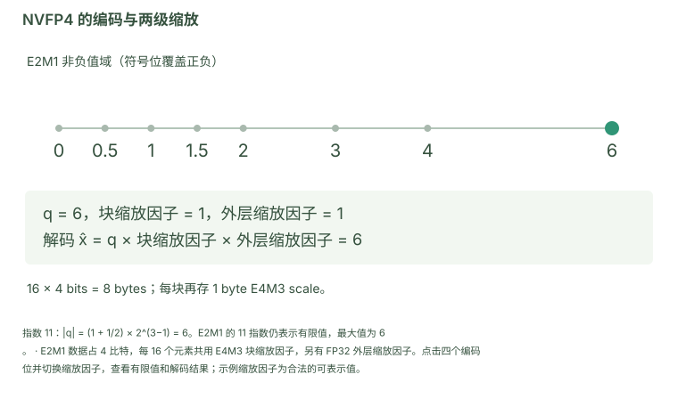

*E2M1 数据占 4 比特，每 16 个元素共用 E4M3 块缩放因子，另有 FP32 外层缩放因子。点击四个编码位并切换缩放因子，查看有限值和解码结果；示例缩放因子为合法的可表示值。*

[打开交互图：悬停查看数值、切换配置、下载 SVG / CSV](miniTE_tech_report_zh.html#figure-format)

Qwen3-0.6B 的 NVFP4 预训练检查点曾因 QKV fuse 结构处理不正确而出现性能崩塌。修正后，BF16、一维量化和二维块缩放量化的 Lambda 平均准确率分别约为 0.3043、0.3056 和 0.3109。这一案例说明，模型转换与结构适配问题需要先被排除，不能直接归结为 FP4 格式不可用。

Qwen3-4B 的在线量化相对 BF16，在 Lambda-base 和 Math23K 上分别下降 0.0355、0.047；离线转换路径又进一步下降 0.0089、0.019。它们将格式及数值路径的损失，与转换和缩放因子处理带来的附加损失分开。

进入 RL 后，两端使用相同格式仍存在明显差异。早期配置的平均绝对对数概率差如下：

| 训练／采样配置 | Dense | MoE |
| --- | --- | --- |
| BF16／BF16 | 0.0110 | 0.0172 |
| NVFP4／NVFP4 | 0.1142 | 0.0668 |
| NVFP4／BF16 | 0.1376 | 0.0621 |
| BF16／NVFP4 | 0.1690 | 0.0747 |

*表 1：早期训推路径对照。Dense 使用 Qwen3-4B，MoE 使用 Qwen3-30B-A3B；结果用于定位该组配置中的误差来源。*

在线量化替换离线 ModelOpt 路径后，dense 的 gap 仍约为 0.1142。我们也尝试让两端调用相同的量化/GEMM 算子，但仍有残余差异。这使排查范围扩展到输入组织、缩放因子计算和量化周围的算子行为。

<a id="section-6"></a>

### 2.3 激活量化、缩放粒度与 KV 缓存

固定 NVFP4 权重，逐步提高激活精度，以比较激活量化的影响。W 和 A 分别表示权重与激活，后面的数字为位宽；例如 W4A16 使用 4 位权重与 16 位激活：

| 权重／激活 | Dense gap | MoE gap |
| --- | --- | --- |
| W4A16 | 0.0139 | 0.0166 |
| W4A8，MXFP8 激活 | 0.0363 | 0.0227 |
| W4A4，NVFP4 激活 | 0.0903 | 0.0445 |

*表 2：使用相应 unquant 推理适配路径的激活精度对照。它与表 1 属于不同阶段的排查，数值不混为同一消融。*

W4A16 将 gap 降至接近 BF16 对照的量级，表明激活量化是这组配置中的重要因素。另一组固定配置中，将 KV 缓存从 FP8 改为 BF16，gap 从 0.0721 降至 0.0583，说明采样端状态的精度也会影响跨端结果。

我们进一步检查缩放范围。采样端逐 token 解码处理当前 token，而训练端通常一次处理整段响应。若激活的外层缩放因子使用全张量 amax，同一个 token 会因同批其他 token 不同而获得不同缩放因子。逐 token（per-token）amax 将这个归约域限制到当前行，是减少这一依赖的直接选择。

为比较解码误差，记参考向量为 $x$、解码向量为 $\hat x$，两者均有 $n$ 个元素。相对 L2 误差定义为 $\|\hat x-x\|_2/\|x\|_2$，信噪比为 $\mathrm{SNR}=20\log_{10}(\|x\|_2/\|\hat x-x\|_2)$，单位为 dB；平均绝对误差为 $\mathrm{MAE}=n^{-1}\sum_{j=1}^{n}|\hat x_j-x_j|$。这里 $\|\cdot\|_2$ 为欧氏范数；相对误差与 SNR 用于非零参考向量。相对 L2 和 MAE 越小越好，SNR 越大越好。

<a id="figure-scaling"></a>

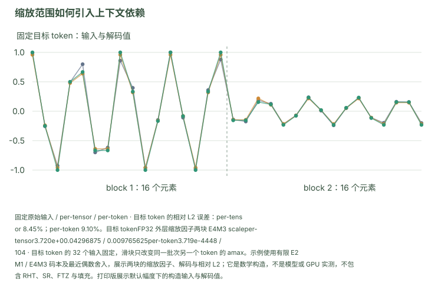

*目标 token 的 32 个输入固定，滑块只改变同一批次另一个 token 的 amax。示例使用有限 E2M1 / E4M3 码本及最近偶数舍入，展示两块的缩放因子、解码与相对 L2；它是数学构造，不是模型或 GPU 实测，不包含 RHT、SR、FTZ 与填充。打印版展示默认幅度下的构造输入与解码值。*

[打开交互图：悬停查看数值、切换配置、下载 SVG / CSV](miniTE_tech_report_zh.html#figure-scaling)

缩放粒度并不决定全部误差。我们对真实 QKV 输入进行 E/M 位宽扫描：固定 E=2、使用 E4M3 缩放因子时，M 从 1 增加到 4，平均 SNR 从 19.88 dB 提高到 34.96 dB，相对 L2 从 0.10140 降至 0.01807；增加指数位则不总是改善结果，还可能与缩放因子表示范围冲突。这些模拟格式用于识别敏感因素，不是新的原生 NVFP4 硬件格式。

改用 per-token amax 后，一组初始步 gap 从 0.05532 变为 0.05501，变化很小，但后续运行记录观察到更平稳的训练。这促使我们继续考察误差的方向、局部结构和训练演化，而不仅是初始平均值。

<details>
<summary>D1 · E/M 位宽探索：真实 QKV、模拟输入与初始 RL 步</summary>

<a id="section-7"></a>

#### 真实 QKV 输入：M 位改变

| 格式 | SNR E4M3 | SNR E8M0 | Rel-L2 E4M3 | Rel-L2 E8M0 |
| --- | --- | --- | --- | --- |
| E2M1 | 19.88 | 17.11 | 0.10140 | 0.13950 |
| E2M2 | 26.23 | 23.98 | 0.04885 | 0.06322 |
| E2M3 | 31.19 | 30.31 | 0.02767 | 0.03051 |
| E2M4 | 34.96 | 36.41 | 0.01807 | 0.01513 |

*表 2-1：真实 prefill/单 token 生成时采集的 36 层 QKV 输入，按层汇总；它不是硬件支持的新 FP4 格式。*

<a id="section-8"></a>

#### 真实输入：增加 E 位的范围与缩放因子问题

| 数据格式 | E4M3 下的 SNR（dB） | E8M0 下的 SNR（dB） |
| --- | --- | --- |
| E2M1 | 19.88 | 17.11 |
| E3M1 | 21.50 | 19.7 |
| E4M1 | 14.39 | 19.7 |
| E5M1 | 0.0(最大值超过 E4M3 范围) | 19.7 |

| 数据格式 | E4M3 下的相对 L2 | E8M0 下的相对 L2 |
| --- | --- | --- |
| E2M1 | 0.10140 | 0.13950 |
| E3M1 | 0.08478 | ～0.103 |
| E4M1 | 0.28937 | ～0.103 |
| E5M1 | 0.99698(最大值超过 E4M3 范围) | ～0.103 |

E8M0 下 E3M1/E4M1/E5M1 在所测输入范围接近；E4M3 与较大数据格式范围的组合可能产生缩放因子范围问题。因此，增加指数位不等价于改善这组输入的精度。

<a id="section-9"></a>

#### 初始 RL 步 gap：E 位与 M 位

| 数据格式 | E4M3 下的初始 gap |
| --- | --- |
| E2M1 | 0.05800700932741165 |
| E3M1 | 0.11516289412975311 |
| E4M1 | 3.412203073501587 |
| E5M1 | nan |

| 数据格式 | E4M3 下的初始 gap |
| --- | --- |
| E2M1 | 0.05800700932741165 |
| E2M2 | 0.042353976517915726 |
| E2M3 | 0.03562581539154053 |
| E2M4 | 0.031815189868211746 |

*表 2-2：实际记录的初始步 gap 与 NaN 结果。它衡量初始一致性，不替代长程训练。*

<a id="section-10"></a>

#### 模拟输入扫描与真实输入的对照

| 数据格式 | 缩放因子格式 | MAE | SNR dB |
| --- | --- | --- | --- |
| E5M1 | E4M3 | 1.485030 | 0.00 |
| E4M1 | E4M3 | 0.132963 | 20.48 |
| E3M1 | E4M3 | 0.127780 | 20.63 |
| E2M1 | E4M3 | 0.154619 | 19.62 |
| E5M1 | E8M0 | 0.128281 | 20.18 |
| E4M1 | E8M0 | 0.128281 | 20.18 |
| E3M1 | E8M0 | 0.128515 | 20.18 |
| E2M1 | E8M0 | 0.176643 | 17.97 |

| 数据格式 | 缩放因子格式 | MAE | SNR dB |
| --- | --- | --- | --- |
| E2M4 | E4M3 | 0.017888 | 36.91 |
| E2M3 | E4M3 | 0.034627 | 31.58 |
| E2M2 | E4M3 | 0.070138 | 26.04 |
| E2M1 | E4M3 | 0.142116 | 20.17 |
| E2M4 | E8M0 | 0.018970 | 37.03 |
| E2M3 | E8M0 | 0.038432 | 30.93 |
| E2M2 | E8M0 | 0.079777 | 24.93 |
| E2M1 | E8M0 | 0.176643 | 17.97 |

*表 2-3：两批模拟输入的 MAE/SNR，分别对应 E 和 M 扫描。它们帮助区分输入分布影响与位宽影响，不能与真实 QKV 均值混为同一重复实验。完整格式汇总如下：*

| 格式 | SNR 均值 | SNR 最差 | MAE 均值 | Rel_L2 均值 |
| --- | --- | --- | --- | --- |
| E2M4 + E8M0 | 36.41 | 35.87 | 0.007954 | 0.01513 |
| E2M4 + E4M3 | 34.96 | 29.58 | 0.007589 | 0.01807 |
| E2M3 + E4M3 | 31.19 | 28.12 | 0.014404 | 0.02767 |
| E2M3 + E8M0 | 30.31 | 29.73 | 0.016283 | 0.03051 |
| E2M2 + E4M3 | 26.23 | 25.03 | 0.027865 | 0.04885 |
| E2M2 + E8M0 | 23.98 | 23.64 | 0.034200 | 0.06322 |
| E3M1 + E4M3 | 21.50 | 17.81 | 0.045411 | 0.08478 |
| E2M1 + E4M3 | 19.88 | 19.53 | 0.058788 | 0.10140 |
| E5M1/E4M1/E3M1 + E8M0 | ~19.7 | ~19.3 | ~0.051 | ~0.103 |
| E2M1 + E8M0 | 17.11 | 16.66 | 0.077184 | 0.13950 |
| E4M1 + E4M3 | 14.39 | 0.71 | 0.067209 | 0.28937 |
| E5M1 + E4M3 | 0.03 | 0.00 | 0.577118 | 0.99698 |

</details>

<a id="section-11"></a>

### 2.4 失配还需要结合更新方向理解

这里用 $A_i$ 表示第 $i$ 条响应的优势值，即该响应相对于同组响应的奖励优势；图中简写为 $A$，并将单个 token 的 gap 简写为 $\delta$。在 GRPO 中，正优势值倾向提高已采样 token 的概率，负优势值倾向降低它。同步权重时，gap 主要反映执行差异；训练端更新后，它还包含相对于固定采样策略的参数变化。

若训练端已低估某个 token（δ < 0），负优势值更新继续下调其概率，会在局部放大差异；正优势值更新则倾向缩小差异。训练端高估该 token（δ > 0）时，两种更新的作用相反。

因此，干预需要同时考虑 gap 大小与更新方向。TRIAGE 根据优势值与 gap 的符号关系识别局部风险。这一局部分析为算法设计提供依据；实际更新方向还受跨 token 耦合和优化器影响。

<a id="figure-direction"></a>

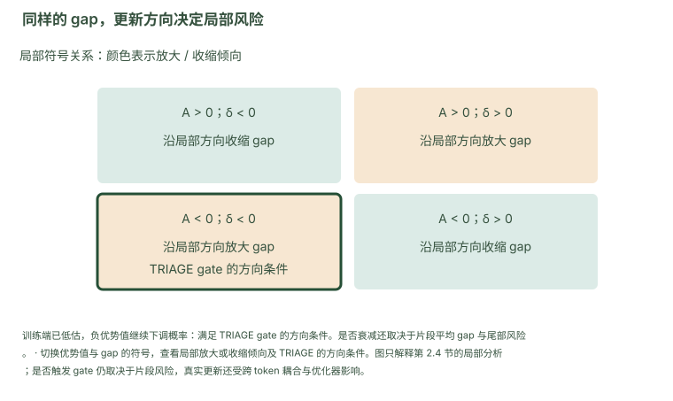

*切换优势值与 gap 的符号，查看局部放大或收缩倾向及 TRIAGE 的方向条件。图只解释第 2.4 节的局部分析；是否触发 gate 仍取决于片段风险，真实更新还受跨 token 耦合与优化器影响。*

**A > 0, δ < 0**

训练端已低估，正优势值上调概率：局部上更接近采样端。TRIAGE repair 根据正优势值响应中的负向片段提供修复信号。

**A > 0, δ > 0**

局部上可能放大差异。TRIAGE gate 关注负优势值、负 gap 的组合，未对所有放大象限统一衰减。

**A < 0, δ < 0**

训练端已低估，负优势值继续下调概率：满足 TRIAGE gate 的方向条件。是否衰减还取决于片段平均 gap 与尾部风险。

**A < 0, δ > 0**

训练端高估，负优势值下调概率：局部上更接近采样端。

[打开交互图：悬停查看数值、切换配置、下载 SVG / CSV](miniTE_tech_report_zh.html#figure-direction)

<a id="section-12"></a>

### 2.5 平均值可能掩盖局部风险

在两个模型各一条诊断轨迹中，方向分布变化先于全局尾部爆炸出现。将响应划分为 64-token 片段后，尾部 token 比例最高的少量片段集中了一部分严重失配；含尾部密集片段的响应仍可能具有很小的平均 gap。

<a id="figure-triage-directional"></a>

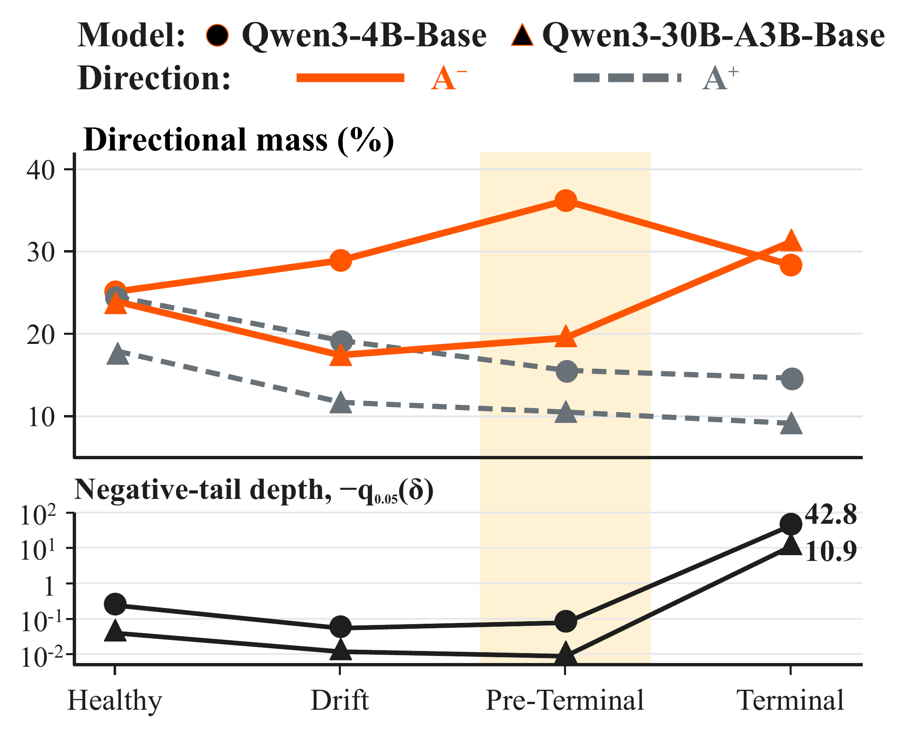

*实验结果*

*图 1：TRIAGE 补充分析中的方向分布与负向尾部。上图为按原始 $|A|$ 加权的方向区域占比，下图为负尾深度 $-q_{0.05}(\delta)$（$q_{0.05}$ 为该组 token gap 的第 5 百分位数，$|A|$ 为优势值的绝对值）。4B 为直接 gap，30B 为 routing replay 后的残余 gap；阶段定义及局部阈值见附录。*

这些探索形成两个具体需求：已有执行栈需要一种管理风险更新的算法；框架开发则需要方便比较缩放因子、精度和算子路径的共同接口。下一节简要介绍 TRIAGE，随后展开 miniTE 如何把对齐、实验迭代和高效执行落实到同一工程体系中。

排查结论 · §2固定 NVFP4 权重时，W4A16 将训推 gap 降至接近 BF16 对照的量级；KV 缓存从 FP8 改为 BF16，gap 从 0.0721 降至 0.0583。

<a id="section-13"></a>

## 3. TRIAGE：通过方向感知稳定原生 NVFP4 RL

<a id="section-14"></a>

### 3.1 核心机制

TRIAGE 在包含截断重要性采样（TIS）等既有重要性修正的策略目标上工作 [[10](#ref-10)]。它保留原生 NVFP4 前向，通过修改策略优化目标管理残余失配。方法包含片段诊断、方向选择性 gate 和有界 repair。

Gate 使用 64-token 片段的平均 gap 与深尾 token 数量判断风险。对负优势值风险片段，只衰减其中负 gap 的 token 的更新权重；其余 token 保持原始权重。随后在响应内归一化加权损失，使干预重分配更新贡献。

Repair 对正优势值响应中的负向片段偏移提供附加信号。它使用 128-token 片段的平均 gap，施加导数有界的单侧 pseudo-Huber 惩罚，提高活跃片段内的训练端对数概率。Gate 减弱风险更新，repair 补充片段级修复；参数和归一化方式见附录 B。

<a id="section-15"></a>

### 3.2 稳定性与任务效果

TRIAGE 的 NVFP4 对照已经在两端使用 per-token 激活缩放。它评估的是这一原生执行栈中的残余失配。在所测训练区间内，TRIAGE 完成了 4B 的 600 步和 30B 的 1,700 步训练；4B 上 TIS 延后了失稳但未完全阻止，30B 上 TIS 完成训练但后期效果较弱。

<a id="figure-triage-training"></a>

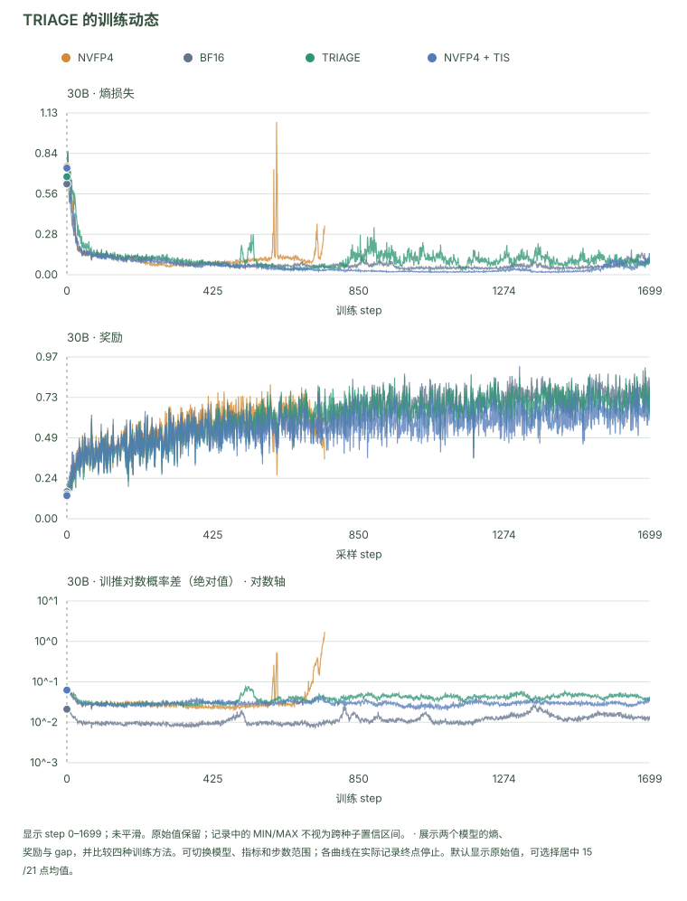

*展示两个模型的熵、奖励与 gap，并比较四种训练方法。可切换模型、指标和步数范围；各曲线在实际记录终点停止。默认显示原始值，可选择居中 15/21 点均值。*

[打开交互图：悬停查看数值、切换配置、下载 SVG / CSV](miniTE_tech_report_zh.html#figure-triage-training)

*图 2：TRIAGE 的训练动态。上排 30B、下排 4B，从左至右为熵损失、奖励及平均绝对 gap。*

| 配置 | 4B 检查点 | 五项数学平均 | 30B 检查点 | 五项数学平均 |
| --- | --- | --- | --- | --- |
| BF16 | 600 | 58.26% | 1,700 | 72.41% |
| NVFP4 | 300† | 47.10% | 700† | 65.87% |
| NVFP4 + TIS | 300† | 50.76% | 1,700 | 63.18% |
| NVFP4 + TRIAGE | 600 | 58.49% | 1,700 | 70.96% |

*表 3：AIME24、AIME25、MATH-500、AMC23 和 GSM8K 的非加权平均 [[11](#ref-11),[12](#ref-12),[13](#ref-13)]。† 表示失稳前保存的检查点；不同时长的最终结果与同预算比较分开解释。*

在共同的 4B 第 300 步检查点上，TRIAGE 取得 53.03%，分别高于同期 NVFP4 和 TIS 5.93、2.27 个百分点。这说明 TRIAGE 的收益也体现在相同训练预算下。框架吞吐则统一在 miniTE 测试环境中评估。

<a id="section-16"></a>

### 3.3 互补的算法与工程

TRIAGE 与 miniTE 从两个位置处理前文定位的问题。TRIAGE 调整存在残余失配时的更新；miniTE 直接检查和改进量化、算子及其调用方式，同时降低执行成本。下面介绍 miniTE 如何支持数值对齐和高效计算。本文分别评估两条线，组合使用的额外收益仍待验证。

<a id="section-17"></a>

## 4. miniTE：对齐数值执行，优化低精度计算

<a id="section-18"></a>

### 4.1 如何同时控制数值差异与执行成本

NVFP4 探索反复涉及几类局部改动：更换激活缩放因子粒度、保留部分层的高精度、修改反向计算格式，以及替换量化或 GEMM 实现。如果这些选择与模型模块、分布式通信和训练脚本紧密耦合，每次实验都需要重新处理外围逻辑，误差定位也更困难。

miniTE 从执行侧处理这些问题：显式指定量化规则，并在相同数值边界上比较训练端与采样端。我们提供普通线性层、LayerNorm 与线性层组合、MoE GroupedLinear 三类模块，通过共同量化接口连接 Python 参考实现与高性能后端。训练任务仍由 Megatron 及上层 RL 系统编排，采样由 SGLang 等推理框架执行 [[7](#ref-7),[8](#ref-8)]。miniTE 聚焦数值策略与算子的接入、比较和优化。

<a id="figure-architecture"></a>

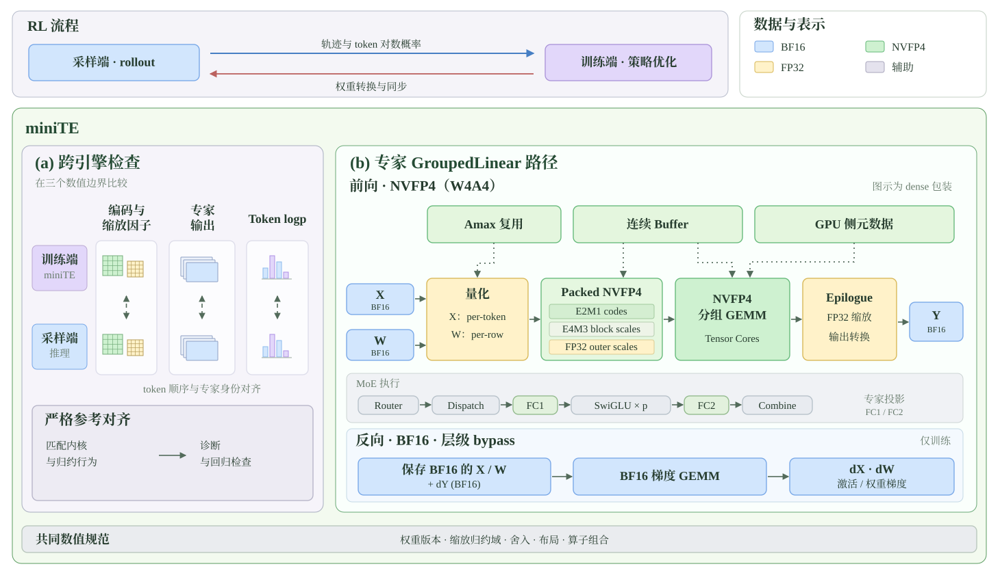

*图 3：miniTE 框架与 MoE 计算路径。右侧展开 GroupedLinear 的 per-token NVFP4 前向与三种反向选择；dense 包装作为图示布局。节点说明对应当前代码中的张量形状、缩放与布局、amax 复用、GEMM 调度和并行约束。训推检查分别比较编码与缩放、专家输出和 token 对数概率，并固定权重版本、缩放归约域、舍入与算子组合。*

[打开交互图：悬停查看数值、切换配置、下载 SVG / CSV](miniTE_tech_report_zh.html#figure-architecture)

<a id="section-19"></a>

### 4.2 接口分层与 Transformer Engine 适配

miniTE 的模块层保留训练框架需要的参数、自动求导与分布式入口；量化策略层描述数据格式和缩放因子；计算后端实现具体量化与 GEMM。开发者可以先用参考实现确认数值行为，再在接口边界内接入 CUDA、CUTLASS 或 TE 实现。

| 层次 | 主要组件 | 开发者修改什么 |
| --- | --- | --- |
| 模块 | `Linear`、`LayerNormLinear`、`GroupedLinear` | 模型接入与分布式封装 |
| 精度配置 | `RecipeSpec`、`get_qlinear_params`、`QLinearParams` | 具名选择、激活/权重/梯度及 fprop/dgrad/wgrad 精度 |
| 量化接口 | `quantize`、`group_quantize` | 量化参数、缩放因子粒度、填充与分组 |
| 矩阵乘法 | `qgemm`及后端实现 | 编码数据、缩放因子布局和 GEMM 调度 |
| 诊断 | 张量统计、性能分析器、跨端采集与比较 | 数值回归与性能定位 |

*表 4：miniTE 的职责划分。新增方案优先在量化策略及后端层完成，公共模块逻辑可以复用。*

TE 适配是设计中的核心要求。miniTE 沿用已有 Linear 类接口和检查点参数命名，使 Megatron 包装层能够替换相应模块，并复用其余训练流程。参数加载、额外状态（extra state）和并行模式则按具体接入路径验证，以兼顾迁移成本和行为一致性。

配方注册表保存名称、用途和依赖元数据，参数工厂将选中的配方转为 `QLinearParams`。注册表与查询入口只依赖 Python 标准库；计算算子在工厂的对应配方分支内导入。开发者可以先检查配置，再准备该路径需要的 CUDA、TE 和编译扩展。参考路径与优化路径继续共用上层模块。

<a id="section-20"></a>

### 4.3 多种精度配方与选择性量化

第 2 节的 W4A16、W4A8 和 W4A4 探索，要求框架能够独立配置权重和激活。miniTE 进一步将梯度精度，以及前向（fprop）、输入梯度（dgrad）、权重梯度（wgrad）的矩阵乘法设置分开。这样，一个新的前向量化方案不必同时绑定一种反向精度。

v1.0.0 通过 `MINITE_RECIPE` 或 `get_qlinear_params` 选择具名配方，例如 `nvfp4_per_token` 和 `nvfp4_per_token_bf16_bwd`。显式传入层的 `qlinear_params` 优先于环境变量选择；按层名覆盖和按层编号关闭量化的入口用于敏感层分析。开发流程可以从参考量化开始，确定缩放因子与编码，再选择 GEMM 后端，比较全精度反向与量化反向。

本文比较的 miniTE CUTLASS 和 miniTE per-token 是两条 MoE GroupedLinear 实现。两者都使用 NVFP4 前向，并按 token 计算激活的外层缩放因子。名称中的 CUTLASS 指矩阵乘法实现，per-token 指缩放方式；它们并不是互斥的技术类别，TE 的 per-token 路径也调用 CUTLASS 内核。两条路径的主要区别如下。

| 比较项 | miniTE CUTLASS | miniTE per-token |
| --- | --- | --- |
| 激活外层缩放 | 每个 token 一份 | 每个 token 一份 |
| 权重外层缩放 | 每个专家的权重张量一份 | 将专家权重展平后，按权重行计算 |
| 量化与 GEMM 接口 | miniTE 自定义打包与 CUTLASS V2 分组 GEMM | TE per-token 批量量化与分组 GEMM；支持 list/dense 包装 |
| 配置名 | `nvfp4_cursor2_cutlass_v2` | `nvfp4_per_token` |

两条路径都分别测试了 MXFP8 反向和 BF16 反向。反向精度由独立设置控制，不能仅凭路径名称判断。本文的 BF16 反向性能结果使用层级 bypass：保存原始 BF16 操作数，跳过反向量化。专用 `nvfp4_per_token_bf16_bwd` 算子是另一种实现，不能直接套用这些性能结果。

<a id="figure-precision"></a>

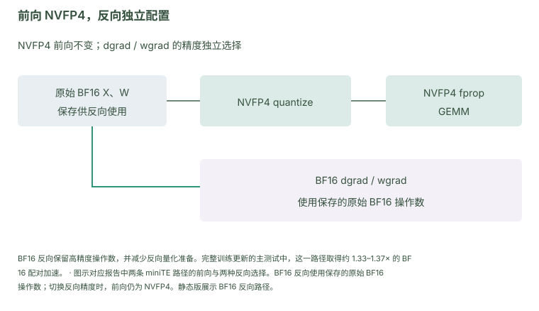

*图示对应报告中两条 miniTE 路径的前向与两种反向选择。BF16 反向使用保存的原始 BF16 操作数；切换反向精度时，前向仍为 NVFP4。静态版展示 BF16 反向路径。*

[打开交互图：悬停查看数值、切换配置、下载 SVG / CSV](miniTE_tech_report_zh.html#figure-precision)

公开入口通过同一注册表解析配方，并按常用配置、参考实现和实验配置组织说明；这些分组表示用途。`describe` 展示前向、反向和布局请求，`doctor` 检查所选路径的运行依赖。各项结果同时注明前向与反向精度、量化覆盖和源码版本。

<a id="section-21"></a>

### 4.4 数值监控、性能分析与训推排查

低精度故障可能到训练后期才暴露，因此 miniTE 提供可配置的数值与性能采集入口。开发者可以按模块、实例、rank 和步数检查激活、权重、输出与梯度的 min/max、均值和范数，并保存张量以复现异常。性能分析器输出 Chrome trace 和内核时间统计，帮助区分计算、数据准备和调用间隙。

比较训练端和采样端时，需要先对齐输入。MoE dispatch 后两端的 token 顺序可能不同，直接逐元素相减会把排列差异误判成数值误差。我们围绕 routing、专家 FC1/FC2 及 token 对数概率设置采集和比较流程，先对齐 token 顺序与专家编号，再比较输出、量化数据与缩放因子。

排查时区分真实内核输出、hook 边界与参考实现重放。某个融合内核内部不可直接采集的中间量，可以用重放帮助定位，但应保留其来源，避免把参考重放的一致误当作真实执行的一致。这些检查方式使每次精度配方或内核修改都能沿“输入与路由、量化、GEMM、输出概率”追踪影响。

<a id="section-22"></a>

### 4.5 训推对齐与确定性实现（Deterministic Mode）

低比特训练的稳定性不仅取决于量化精度本身，还取决于训练和推理两侧的算子行为是否严格一致。即使两侧使用相同的量化策略，只要算子实现、归约顺序或并行策略有细微差异，就可能累积成不可忽视的数值偏差，最终影响训练效果。

为此，我们在 miniTransformer 中实现了**确定性模式（deterministic mode）**：通过逐层替换 Megatron 侧的算子实现，使其与 SGLang 推理侧使用同一条 kernel、同一套公式、同一种归约顺序，最终在已检查的多个关键层上达到 **bit-exact** 的一致性。

这项逐层对齐与第 4.4 节的张量、路由身份检查配合使用。原记录中，严格配置关闭 TIS，非严格参考使用 TIS，因此下图保留这些执行路径与算法修正的共同配置身份；关键层的 bit-exact 与端到端对数概率差分别报告。

<a id="figure-deterministic"></a>

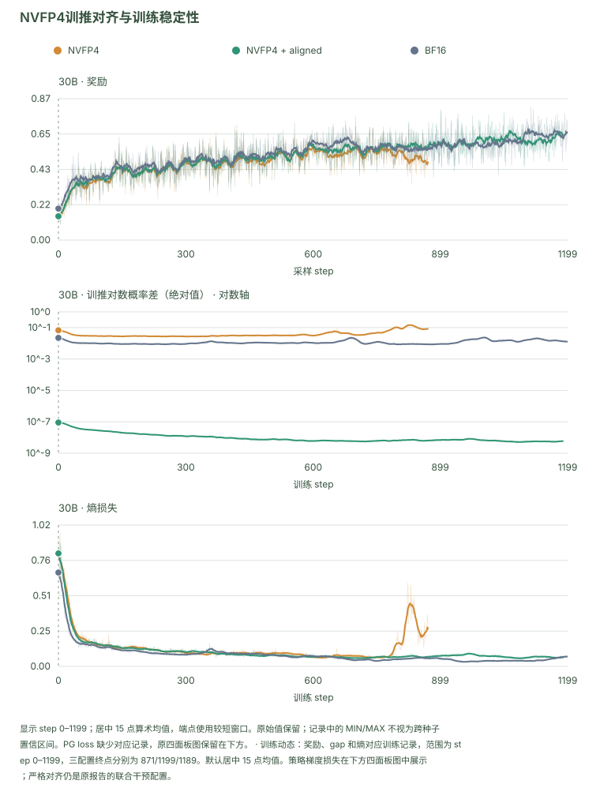

*训练动态：奖励、gap 和熵对应训练记录，范围为 step 0–1199，三配置终点分别为 871/1199/1189。默认居中 15 点均值。策略梯度损失在下方四面板图中展示；严格对齐仍是原报告的联合干预配置。*

[打开交互图：悬停查看数值、切换配置、下载 SVG / CSV](miniTE_tech_report_zh.html#figure-deterministic)

<details>
<summary>奖励、gap、熵与策略梯度损失</summary>

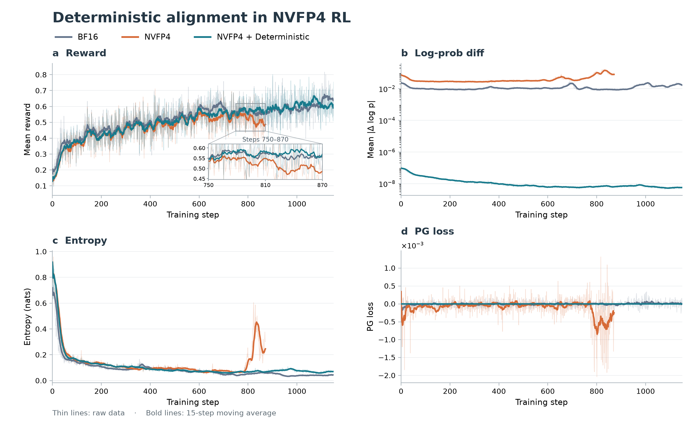

</details>

*图 4：训推对齐实验。展示奖励、平均绝对对数概率差、熵及策略梯度损失；粗线为 15 步滑动均值。对齐配置在所测区间的 gap 约为 $10^{-8}$，并保持较平稳的后期奖励。这是多个实现选择共同变化的对照，不是只切换一个开关。*

在本组实验中，对齐版本的训推 log-prob diff 降至约 $10^{-8}$，reward 后期保持稳定、扰动较小；未对齐 NVFP4 则在后期出现 reward 明显回落，并伴随 entropy 和 log-prob diff 上升。这表明在该配置下，较小的训推差异与更平稳的 NVFP4 RL 训练动态相伴。本图是不同实现配置的单次训练对照，涉及多个实现选择共同变化；对齐实验与吞吐测试也属于不同实验，性能结论仍以第 6 节对应配置的直接测量为准。

因此，miniTE 的价值包括对齐能力，也包括实现这种能力所需的配置、调试和扩展入口。它使新的低精度策略能够经历同一套从局部正确性到 RL 训练的验证过程。

训推对齐 · §4.5严格对齐配置下，所测区间的训推对数概率差约为 10⁻⁸，并保持较平稳的后期奖励。

<a id="section-23"></a>

## 5. 与 Transformer Engine 联合推进 NVFP4 实现与加速

<a id="section-24"></a>

### 5.1 Per-token 与 per-tensor 的数值及实现选择

我们与 NVIDIA 围绕 TE 的 NVFP4 能力开展联合测试与实现，并以 per-token 精度配方及相关接口为重要连接点 [[9](#ref-9)]。不同缩放因子粒度决定数值行为，也改变 amax 计算、缩放因子存储和 GEMM epilogue 的成本，因此需要一起评估精度和速度。

NVFP4 在每 16 个元素上使用 E4M3 块缩放因子，数据使用 E2M1 编码，并由外层 FP32 缩放因子调节范围 [[1](#ref-1)]。若 $s_i$ 是第 $i$ 行外层缩放因子，$b_{i,j}$ 是长度为 16 的块，则

$$
d_{i,j}=Q_{\mathrm{E4M3}}\!\left(\frac{\operatorname{amax}(b_{i,j})}{6s_i}\right),
\qquad
\hat x=s_i d_{i,j}Q_{\mathrm{E2M1}}\!\left(\frac{x}{s_i d_{i,j}}\right).
$$

Per-tensor 使用整个张量共享的外层缩放因子，per-token 则逐行计算。后者减少对其他 token 峰值的依赖，并能缓解跨行幅度相差很大时块缩放因子接近下溢区的问题。它不会消除行内动态范围或 FP4 舍入误差，也需要更细粒度的计算支持。公开系统中也采用了 per-token NVFP4 前向与较高精度反向的组合 [[2](#ref-2)]。

我们据此保留多种精度配方用于比较，将精度选择与实现优化分开验证。不能仅由某个缩放因子策略在局部张量上的误差更小，就推出完整 RL 路径更稳定；同样，新增归约的成本也需要通过整条计算路径测量。

<details>
<summary>D2 · per-token/per-tensor 的 20k 步语言模型损失对照</summary>

<a id="figure-language-loss"></a>

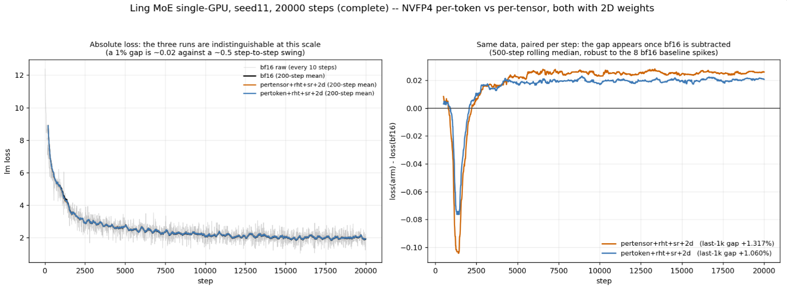

*实验结果*

*图 5-1：Ling MoE 单 GPU、seed 11、20,000 步；两种 NVFP4 配置均使用 RHT、SR 与二维权重量化。左图为绝对损失，右图减去同数据 BF16 后展示差异；末尾 1k 区间的相对 gap 标注为 per-tensor+1.317%、per-token+1.060%。*

绝对损失在图示尺度接近，按相同数据减去 BF16 才显现较小差别。该实验提供缩放因子选择的长期语言模型损失证据；它不是§6.2.2 的 RL+TIS 轨迹，也不据此单独证明 RL 稳定性。

</details>

<a id="section-25"></a>

### 5.2 连续布局与 grouped GEMM 调用组织

原始分组接口可能把量化结果和缩放因子拆成多个专家张量，再在 GEMM 端重新建立指针、步长和布局。专家数增加后，Python/ATen 切分、list 构建、临时分配和 host 到 device 参数传递可能抵消 FP4 算术收益。

我们将量化输出组织为连续 buffer，以 offset 描述专家边界，直接交给 dense grouped GEMM。FP4 数据、块缩放因子和外层缩放因子沿同一接口传递，避免量化后拆开、调用前重新组装。Device 侧构建参数并复用工作区，减少重复分配与同步拷贝；零 token 专家和填充也在这条分组路径中统一处理。

这一优化改变的是数据组织和调用方式。Dense 量化与 GEMM 接口分别与原 list 路径比较操作数及输出，性能则测量组合实现。后续版本`b641179`将 dense 路径与 GEMM 配置、融合串联，核心重复测试仍保留其原版本身份。

<a id="section-26"></a>

### 5.3 在数据产生时计算 amax

独立 amax 内核需要先扫描激活，再由量化内核重新读取。我们沿数据生产到消费的路径，寻找已经遍历这些数据的操作。

对于 MoE FC1，输入经过 dispatch 和 permute，因此可在 token 重排时同时累计逐行 amax。Padding 阶段一起处理激活与 amax，使量化端复用外部统计，跳过重复归约。

对于 MoE FC2，amax 更适合融合到 activation 计算中。我们选择 `_weighted_swiglu_row_amax_kernel` 作为融合 kernel，参考 JIT compile 出来的实现，在遍历 col 方向时顺带累计 amax。统计作用于 SwiGLU 输出施加 router 权重后、实际交给 FC2 量化器的张量；归约复用原本的访存和计算路径，避免再为 amax 单独扫描完整 FC2 输入。

FC1 优化前后的差别是：

```text
原路径：sort → pad(activation) → amax → quantization
融合后：sort + amax → pad(activation, amax) → quantization
```

FC2 则在生成加权激活时一起产出 amax，后续量化复用这一统计：

```text
原路径：SwiGLU × router weight → activation → amax → quantization
融合后：weighted SwiGLU + row-amax → activation、amax → quantization
```

这里的收益应覆盖 producer、填充和 consumer。模块级跳过 amax 的模拟测试并不总是更快，说明减少一个内核不能单独代表完整流程收益；第 6 节使用包含外围工作的训练端计时报告结果。

<a id="section-27"></a>

### 5.4 内核级优化与适用范围

Kernel 级优化分别处理 amax 跨 CTA 归约、FC1/FC2 GEMM 流水线、scale 布局传递，以及 activation/amax 在 epilogue 中的融合。以下给出实现细节与适用范围。

<details open>
<summary>展开：Kernel 级优化实现细节</summary>

**1. Row-amax：用 cluster shared memory 做 CTA 间归约。** Per-token NVFP4 的 K1 阶段需要为每一行求跨 K-tile 的 amax。原路径用跨 tile 的 `atomicMax` 汇总。优化路径先让 cluster 内各 CTA 计算 partial amax，并写入 leader CTA 的 shared buffer，再由 leader 完成 cluster 内归约；当一个 cluster 覆盖全部 K tiles 时可直接得到最终 row-amax，超出覆盖范围则回退 atomic。测试中 `n_cluster=16`、`k_tile=128` 可覆盖 K=2048，增至 256 可覆盖 K=4096。它只替换 K1 amax，K2 cast 仍独立执行；multi-cluster 方案没有收益，已移除。因此适用于单 cluster 能覆盖或大部分覆盖的 K 范围，不能将这一收益直接外推到更大 K。

**2. FC1/FC2 GEMM：按归约长度选择 tile 与 pipeline。** 两层虽然都使用 grouped NVFP4 GEMM，但 K 长度和 epilogue 重叠条件不同。FC1 的 K 较长、MMA 主循环更长，较大的 `MMA_N=256` 配合 `2SM` 能提高单 CTA 处理量，并让 epilogue 工作更容易与 MMA 重叠。FC2 的 K 较短，若沿用 256 列及 `OverlappingAccum`，epilogue 反读可能与下一 stage 的 MMA 写入争用，因此采用 `MMA_N=128`、`2SM`。此外，TMEM 共 512 列，256 列 tile 使用 2-stage 会占满容量，无法再容纳 scale，需配套选择 OverlappingAccum，而非沿用默认 TMEM 分配。这是针对所测 FC1/FC2 形状的配置，其最优选择随 shape 变化。

**3. Fused swizzle：在 cast 时直接写 GEMM 所需的 scale 布局。** 下游 GEMM 需要特定的 swizzled scale-factor layout。原实现先生成 compact M-major scale，再启动独立的 `nvte_swizzle_scaling_factors` 转换，增加一次 kernel launch 和全局内存读写。融合实现为 `launch_grouped_fused_cast_bf16` 增加 `with_swizzle` 路径，在 `DO_ROW` 中直接按 cuBLASLt 128M × 4K tile layout 写出；关闭时仍保留 compact 布局及原独立转换路径。这样省去中间 scale 重排，优化的是布局传递成本，量化公式保持不变。miniTE per-token 后续专项测试中，fused/unfused 的量化数据、还原到同一布局后的 scale 与最终输出逐位一致。

**4. Activation 与 epilogue 融合：FC1 输出后就地完成门控激活与统计。** MoE FC1 的输出是 gate/up 配对张量，通常紧接 SwiGLU 或 GeGLU，并需要为后续量化计算输出侧 amax。融合 epilogue 同时完成 α/bias 修正、gate/up 配对的激活、router 概率加权和 D 侧 amax；按配置保留可选的 GLU 前中间 C 写出，FP8 路径还可生成输出 scale factor。核心数据流为：

```text
ACC = block-scaled GEMM(A, B)
ACC = ACC × α_a[m]（可选再乘 α_b[n]）+ bias
C = gate | up（GLU 前，宽度 N；按需写出）
D = act(gate, up) × prob（SwiGLU/GeGLU，宽度 N/2）
同时归约 D 的 amax；FP8 路径可生成输出 scale factor
```

就地完成 activation 和统计，可减少完整 gate/up 中间结果写回、随后再次读入的流量，以及独立 activation/amax kernel 的启动。该融合当前针对前向，适用于 FC1 输出立即进入门控激活及量化统计的路径。各项优化是否纳入主性能配置单独记录，完整收益仍由相应模块和 learner 计时给出。

</details>

<a id="section-28"></a>

### 5.5 联合测试怎样支持实现选择

我们将联合工作组织为“参考实现、优化实现、模块对照、模型测试”。同一精度配方比较用于验证接口和布局变化；不同精度配方比较用于评估精度选择及其成本。BF16、TE 原生 NVFP4、自研 CUTLASS 路径和上游 per-token 路径分别承担不同基线角色。

这套流程使 TE 能力能被 miniTE 接入，也使 miniTE 探索中的瓶颈能回到 TE 接口和内核层处理。公开 per-token 实现与讨论见 PR #3045 [[9](#ref-9)]。具体版本、补丁和测试范围随结果给出，贡献归属与上游合入状态按实际记录区分。

<a id="section-29"></a>

### 5.6 单遍融合的进一步探索

我们还研究了 online amax 补偿，用于不物化完整中间激活的融合 SwiGLU-FFN 路径。FC2 沿 K 维消费激活 tile，但处理早期 tile 时，全行 amax 尚未得到。这个方法维护逐行 running amax，并在外层 scale 增大时，把此前部分累加转换到新的尺度，连接 FC1、SwiGLU、量化和 FC2。

这条路径主要减少中间激活写读和独立 kernel 调用。补偿保证的是各 tile 贡献在累加时的尺度一致性；提前量化得到的 E4M3 block scale 和 E2M1 编码，则仍取决于当时的 scale 与舍入。因此，我们将它作为融合研究方向，分别评估补偿误差、与 two-pass 的量化差异和完整调用链收益。

<details>
<summary>展开 Online Amax 补偿量化</summary>

#### 算法：在当前行尺度下累计 FC2 的部分输出

记 $P_i$ 为第 $i$ 个 FC2 K-tile 的 SwiGLU 激活。先完成该片 gate/up 的 FC1 归约，再计算 SwiGLU、逐行绝对值最大值与 16 元素 block 的最大值。逐行 running amax 及外层 scale 为

$$
g_i=\max\bigl(g_{i-1},\operatorname{rowmax}(|P_i|)\bigr),\qquad
gs_i=\frac{g_i}{2688},\qquad 2688=6\times448.
$$

对 block $b$，量化器生成 $bs_{i,b}=Q_{\mathrm{E4M3}}\bigl(\operatorname{amax}(P_{i,b})/(6gs_i)\bigr)$ 与 $q_{i,b}=Q_{\mathrm{E2M1}}\bigl(P_{i,b}/(bs_{i,b}gs_i)\bigr)$。FC2 块缩放 MMA 计算

$$
\Delta O_i=(q_i\odot bs_i)\,\widetilde W_{2,i},\qquad
O_i=O_{i-1}\frac{gs_{i-1}}{gs_i}+\Delta O_i,
\qquad Y=O_k\,gs_k\,gs_{W2}.
$$

这里 $\widetilde W_{2,i}$ 已包含权重的块缩放，但不包含沿 K 维不变的外层权重 scale $gs_{W2}$；激活逐行 scale 与权重外层 scale 在最终输出中按对应维度广播。若权重外层 scale 随 tile 改变，应把该变化计入每个 partial，不能统一留到末尾。激活的 `bs` 在 MMA 内按 block 应用，只有外层 `gs` 被推迟到 epilogue。

#### 数值条件：避免饱和不等于任意 gs 下误差不变

对固定数据，$gs\ge\operatorname{amax}(P)/2688$ 保证未舍入的 block scale 不超过 E4M3 上限 448。在线算法的 running amax 至少覆盖当前 tile 的最大值，因此当前 tile 满足这一防饱和条件。

在不考虑 E4M3 舍入时，$bs\cdot gs=\operatorname{amax}(P_b)/6$，外层 scale 的变化可以被 block scale 抵消。实际 `bs` 需要舍入，乘积会保留与 `gs` 有关的舍入残差；`gs` 过大还可能让小 block 进入亚正规或下溢区。二的整数次幂缩放在码本保持正常数、未触及边界且舍入规则一致时，可保持相同的解码步长；任意比例缩放不具有这一保证。

原重尾用例中，一行激活的 amax 约为 29。设计 scale 与其 4 倍的 rel-L2 都是 0.099，而降低到设计值的四分之一时，rel-L2 升至 0.52：

| 外层 scale | rel-L2 | block scale 上界情况 |
| --- | --- | --- |
| amax / 2688 | 0.099 | 1/16 恰好达到 448，未越界 |
| 4 × amax / 2688 | 0.099 | 没有 block 达到上界 |
| amax / (4 × 2688) | 0.52 | 6/16 超过上界并被截断 |

这组示例展示了防饱和条件的作用，以及该倍数缩放下的相同误差；它没有证明所有满足下界的 scale 都产生相同编码或误差。

#### 补偿依据：partial 必须在同一外层尺度下合并

$\Delta O_i$ 尚未乘回本 tile 的 $gs_i$，因此不同 tile 的 partial 不能直接相加。递推式把旧累加器换算到当前尺度；在理想实数运算下展开得到

$$
O_i=\sum_{j\le i}\Delta O_j\frac{gs_j}{gs_i},\qquad
O_k gs_k gs_{W2}=\sum_j\Delta O_j gs_j gs_{W2}.
$$

这个等式恢复的是每个已量化 tile 应有的外层 scale。它不会重算早期 tile 的 `bs` 或 `q`，所以不能据此推出与预先知道全行 amax 的 two-pass 方案逐位等价。FP32 中的比值、乘法和累加也会舍入，需要在数值对照中单独检查。

原诊断示例使用 amax 分别为 1 和 100 的两个 slice，以 FP32 结果为参考。不同尺度的 partial 直接相加产生 2618% 的 rel-L2；逐 slice 乘回 scale 后相加，以及顺序式 ratio 补偿，记录的 rel-L2 均为 6.0%，回到该用例的量化误差范围。

| 合并方式 | rel-L2（%） | 对应含义 |
| --- | --- | --- |
| 两个 partial 直接相加 | 2618 | 把不同外层尺度的输出混在一起 |
| 分别乘回各自 gs，再相加 | 6.0 | 恢复逐 tile 的实际贡献 |
| 运行尺度 ratio 补偿，最后乘回 gs | 6.0 | 用递推形式完成同一尺度换算 |

#### 实现流程与开销

融合原型面向 SM100（Blackwell）的 CuTeDSL 核。FC1 在 TMEM 中完成该片 gate/up 的累加，随后转入寄存器执行 SwiGLU、绝对值 rowmax 与量化，并把 running amax 写入工作区。FC2 直接消费 E2M1 数据和 E4M3 block scale；epilogue 把 partial 从 TMEM 取出，在寄存器或 SMEM 中补偿合并。正常数范围下的核心流程为：

```text
输入 X、W_FC1、W_FC2
初始化 gamax = 0、gs_prev = 0、O = 0
for 每个 FC2 K-tile i:
    FC1 完成对应 gate/up 片的归约 → SwiGLU → P_i
    rowmax = max(|P_i|)；gamax = max(gamax, rowmax)
    若 gamax = 0：本行当前贡献为零，跳过计算
    gs = gamax / 2688
    按 16 元素 block 生成 E4M3 bs 与 E2M1 q
    FC2 块缩放 MMA → ΔO_i（包含 block scale，不包含 gs）
    O = O × (gs_prev / gs) + ΔO_i
    gs_prev = gs
Y = O × gs_prev × gs_W2；全零行输出零
```

SwiGLU 输出可能为负，rowmax 必须使用 `max(|P|)`。全零行或全零 block 需显式设置 `q=0`，避免 `0/0`；非零 block 的 scale 若发生下溢，也应按量化器的零值规则处理并统计相应误差。

这条路径避免写读完整 FP32 中间激活，但输出累加器 `O` 需要在 TMEM 外维护，每个 K-tile 都有 partial 搬运与 merge。补充的 B200、Qwen3-30B-A3B 形状测试记录中，原型相对 TE 非融合两级链快 4–8×，精度接近 TE 两级路径；与融合单级路径相比，512-token 小 batch 的 merge 成本更明显，4096-token 负载下差距约为 5%。这使 prefill 和较大 batch 成为更适合继续评估的负载。该原型形状测试与第 6 节 B300 的完整 learner 测试分别计量。

</details>

<a id="section-30"></a>

## 6. 实验：从数值正确性到完整执行收益

本节验证前述实现选择：先检查量化、接口、矩阵乘法和梯度的正确性，再评估长期学习效果，最后依次测量完整训练更新、模块、推理服务与在线 RL 阶段的成本。各组实验既给出结果，也说明这些结果如何影响实现选择。

主文展示关键趋势和核心结果，完整形状、梯度、重复运行与配置数据附在相应小节。网页版可按标题查看详细数据；打印时，这些数据集中列入附录 C。

<a id="section-31"></a>

### 6.1 实验设置与证据边界

本节报告 miniTE 的系统性能；TRIAGE 的算法效果见第 3 节。性能测试模型为 Qwen3-30B-A3B，单节点 8×B300，TP/PP/CP/EP 为 1/1/1/4。训练端测试使用 sequence4096、微批次1、GBS128，每次更新处理 524,288 token，共享检查点、seed 和冻结 DAPO 文本。模块、训练端、推理服务及在线 RL 阶段具有各自计时范围。

| 实验 | 直接检验的问题 | 计时或数值边界 |
| --- | --- | --- |
| 量化/API/GEMM/梯度 | 优化是否改变数值？误差来自编码、缩放因子还是计算？ | 参考内核或 FP32 golden；同输入比较 |
| 长期训练与任务评测 | 配置能否持续有效学习？ | 训练轨迹和同检查点的独立评测 |
| 模块前向 / 直接 F+B | 局部实现收益与反向成本在哪里？ | 量化与专家 GEMM；dispatch 不计入 |
| 固定文本训练端 update | 局部优化能否进入完整训练更新？ | 前向、反向、通信、优化器及数据加载 |
| 固定输出推理服务 | 低精度采样容量提高多少？ | 八推理实例输出吞吐；不含训练端或同步 |
| 在线 RL 阶段 | 计算收益被什么系统成本消耗？ | logprob+actor train 与转换/同步分开记录 |

<details>
<summary>D3 · 实验配置、前后向精度及统计单位</summary>

| 配置 | 前向路径 | 反向/量化范围 | 比较用途 |
| --- | --- | --- | --- |
| TE BF16 | TE BF16 GroupedLinear | BF16 | 高精度参考与性能基线 |
| TE NVFP4 | TE 原生 per-tensor NVFP4 | 所测原生精度配方；非专家层 BF16 | 既有 NVFP4 路径 |
| miniTE CUTLASS | 自研 CUTLASS NVFP4 | 分别测 MXFP8 与 BF16 反向 | 自研路径与精度选择 |
| miniTE per-token | 基于 PR #3045 的 per-token NVFP4 | 分别测 MXFP8 与 BF16 反向；仅量化专家层 | per-token 路径及优化链 |
| TE per-token | 固定上游 per-token 实现 | 模块前向同一精度配方；全模型测试的范围/反向另见边界 | 模块实现参考与配置计时参照 |

*表 6-1：比较身份。两条 miniTE 路径均保留 MXFP8 和 BF16 反向；主要训练端配置使用 BF16 反向。*

- 模块使用五次独立进程运行，各次运行在稳态 block 上取中位数；4k/16k/64k/128k 指每 rank、dispatch 前 token 规模。
- 核心训练端使用十次独立运行，每次运行执行 20 次更新；前五次预热，第 6–15 次更新测量。吞吐和配对速度比各按自己的序列去最高/最低再平均。
- 完整优化链每个配置运行一个进程，共 17 次更新；前两次预热，其余 15 次耗时去掉最大值和最小值后，取 13 次平均耗时换算吞吐。这 13 次更新属于同一个进程。
- 核心版为 miniTE953f17f9；优化轮为 b641179，包含 dense、GEMM-kind 与 fusion。TE 的零专家处理更新和运行3 干扰见附录 A.3。

</details>

<a id="section-32"></a>

### 6.2 正确性与学习：数值选择是否保持预期行为？

<a id="section-33"></a>

#### 6.2.1 量化、API、GEMM 与梯度分别验证

我们先在局部边界确认数值，再进入完整训练。对 API 和布局优化，比较固定精度配方下的编码、缩放因子与输出；对量化计算，与反量化后 FP32 参考比较；对反向，以直通估计（STE）语义的 FP32 梯度检查方向、幅度及符号。这样能区分“格式固有误差”与“优化新增误差”。

miniTE per-token 的 dense quant 与 grouped GEMM 完成 28/28 项逐位等价检查，fused 布局在七个合成及真实激活用例上也没有额外偏差。这些检查表明，在所测配置下，数据布局优化保持了原有量化结果。

<details>
<summary>D4 · 8 类算子路径与参考实现对应关系</summary>

| 类别 | 算子 / 路径 | 测试目标 | 参考实现 / 判定口径 |
| --- | --- | --- | --- |
| **miniTE CUTLASS** | `group_quantize_nvfp4_pertoken_swizzled` | 激活 per-token NVFP4 量化 | 与逐分组参考内核 **bit-exact**；dequant 行为符合 FP4/E4M3 缩放因子语义 |
| **miniTE CUTLASS** | `group_quantize_nvfp4_tensor_global_packed` | 权重 per-tensor/global NVFP4 打包 | FP4 data 与 swizzle 布局的缩放因子 对齐 逐专家 `quantize_weight_nvfp4_swizzled` |
| **miniTE CUTLASS** | `grouped_cutlass_gemm_v2` / `v2_evt` | FP4 grouped GEMM | dequant 后 FP32 GEMM golden |
| **CUTLASS 端到端** | miniTE CUTLASS GroupedLinear | 模块级前向与反向 | 纯 BF16 grouped matmul / fp32 golden 梯度 |
| **miniTE per-token** | `nvfp4_per_token_group_quantize_bulk_dense` | TE per-token group quant dense API | PR#3045 list API，要求 **bitwise identical** |
| **miniTE per-token** | `nvfp4_cutlass_grouped_per_token_gemm_dense` | TE per-token grouped GEMM dense API | PR#3045 list API，要求 **bitwise identical** |
| **miniTE per-token** | fused swizzle / unfused swizzle | 缩放因子布局融合是否引入额外数值偏差 | fused 与 unfused 端到端 **bit-exact** |
| **两条 miniTE 路径的反向** | dgrad / wgrad | 训练反向梯度正确性 | fp32 golden 梯度；STE 语义下 cosine 预期 > 0.99 |

*表 6-2：正确性检查的对象与参考。*

</details>

<details>
<summary>D5 · 极端输入、subnormal 与缩放因子归零行为</summary>

| 测试项 | 结果 | 说明 |
| --- | --- | --- |
| CUTLASS 激活量化与权重打包 | **50 passed** | 包含新增 16 个极端用例，8 个 bench 用例 deselected |
| per-token dense 量化极端输入 | **8 passed** | 覆盖 miniTE per-token dense quant 的极端输入 |
| CUTLASS 权重布局参数回归 | **8 passed** | 既有 bit-exact 回归未受影响 |

*表 6-3：极端输入工程回归。Passed 数量描述实际用例覆盖，不作为模型训练稳定性或统计显著性的证据。*

- **激活 per-token 量化**：FP4 数据及缩放因子与逐分组参考逐位一致；极大值、接近 BF16 max、subnormal 和混合量级输入不产生 NaN/Inf。Subnormal 行的全局缩放因子可能 FTZ 到零，对应归零行为。
- **权重 per-tensor/global 打包**：编码和 swizzled 缩放因子对齐 逐专家参考；subnormal 专家保留约 9e-41 量级输入，Rel-L2 约 1.56e-2。全局缩放因子检查采用 3%相对容差，而非宣称全部浮点缩放因子逐位一致。
- **miniTE per-token dense per-token quant**：q_row、块缩放因子与 row_amax 对齐上游 list 路径；极小行可因 块解码缩放因子下溢归零。所测生产路径要求 m_splits 为 128 的倍数。

不同路径的归零行为取决于缩放因子的计算方式和浮点数下溢处理。

</details>

FP32 epilogue 的选择也有直接数据依据。miniTE CUTLASS 普通 grouped GEMM 与 EVT 路径都与 dequant 后的 FP32 golden 比较：

| 内核 | cosine | max_abs | norm_rmse |
| --- | --- | --- | --- |
| `grouped_cutlass_gemm_v2` | ≥ 0.999994 | ≤ 0.0156 | ≤ 0.0033 |
| `grouped_cutlass_gemm_v2_evt` | ≥ 0.999999 | ≤ 0.0078 | ≤ 4e-5 |

*表 6-4：miniTE CUTLASS GEMM 精度。EVT 将 norm_rmse 上限从约 0.0033 降至 4e-5 量级，支持在该路径使用高精度 epilogue。*

GroupedLinear 与纯 BF16 前向的 cosine 约 0.99095、norm_rmse 约 0.135，明显大于 GEMM 对自身 dequant 参考的误差。前者包含 FP4 信息损失，后者用于检查 GEMM 实现；这两种参考实现不能混为一个“精度”指标。

BF16 反向的 dgrad/wgrad 与 BF16 参考基本重合，最大相对 L2 约 0.001663；MXFP8 反向的相对 L2 约 0.03765，符号一致率约 98.8%。这给第 4 节独立选择反向精度提供了数值依据，运行成本则在§6.4 比较。

<details>
<summary>D6 · 两条 miniTE 路径的完整梯度矩阵：cosine、Rel-L2、sign%与专家指标</summary>

| Backend | 反向口径 | dgrad cosine（最小） | dgrad rel-L2（最大） | dgrad 符号一致率（最小） | wgrad cosine（最小） | wgrad rel-L2（最大） | wgrad 符号一致率（最小） | 专家 cosine（最小） |
| --- | --- | --- | --- | --- | --- | --- | --- | --- |
| miniTE CUTLASS | MXFP8 bwdquant | 0.999292 | 0.037626 | 98.802% | 0.999291 | 0.037653 | 98.802% | 0.999287 |
| miniTE per-token | MXFP8 bwdquant | 0.999292 | 0.037626 | 98.802% | 0.999291 | 0.037653 | 98.802% | 0.999287 |
| miniTE CUTLASS | BF16 反向 | 0.999999 | 0.001660 | 100.000% | 0.999999 | 0.001663 | 100.000% | 0.999998 |
| miniTE per-token | BF16 反向 | 0.999999 | 0.001660 | 100.000% | 0.999999 | 0.001663 | 100.000% | 0.999998 |
| BF16 torch 对照 | BF16 matmul | 0.999999 | 0.001660 | 100.000% | 0.999999 | 0.001663 | 100.000% | 0.999998 |

*表 6-5：多个随机种子与形状 的最差梯度指标。参考为 $dX=dY\,W_{\mathrm{BF16}}^\top$、$dW=dY^\top X_{\mathrm{BF16}}$ 的 FP32 计算。100%符号一致不表示与 FP32 逐位相等。*

</details>

<details>
<summary>D7 · dense 接口与 fused/unfused 缩放因子布局的数据</summary>

| 测试对象 | Shape 覆盖 | 结果 |
| --- | --- | --- |
| `nvfp4_per_token_group_quantize_bulk_dense` | small、8 experts、32 experts、极端输入 | q / 缩放因子 / amax 全部 **bitwise identical** |
| `nvfp4_cutlass_grouped_per_token_gemm_dense` | small、fc1-ish、fc2-ish | GEMM 输出 **bitwise identical**，max_abs = 0 |

*表 6-6：Dense 接口的 shape 覆盖与结果。*

| Case | fused vs unfused Rel-L2 | cosine | max_abs | FP4 data mismatch | 缩放因子 mismatch |
| --- | --- | --- | --- | --- | --- |
| synthetic 多 seed / 多 token 数 | 0 | 1.0 | 0 | 0 / 96 groups | 0 / 96 groups |
| real dump | 0 | 1.0 | 0 | 0 / 12 groups | 0 / 12 groups |

*表 6-7：Fused/unfused 输出与中间量差异。miniTE per-token 的生产路径与早期实验路径使用不同的形状约束；表中给出生产路径的独立检查结果。*

</details>

<a id="section-34"></a>

#### 6.2.2 长期学习的补充验证

图 5 比较 BF16+TIS、原生 NVFP4+TIS 和 miniTE+TIS。miniTE 在前 1,000 步保持奖励增长，后期高于原生 NVFP4，BF16 在该区间取得更高奖励。两个 NVFP4 配置的平均对数概率差接近，但学习轨迹不同。因此，平均 gap 不能单独充当任务效果的替代指标。

<a id="figure-learning"></a>

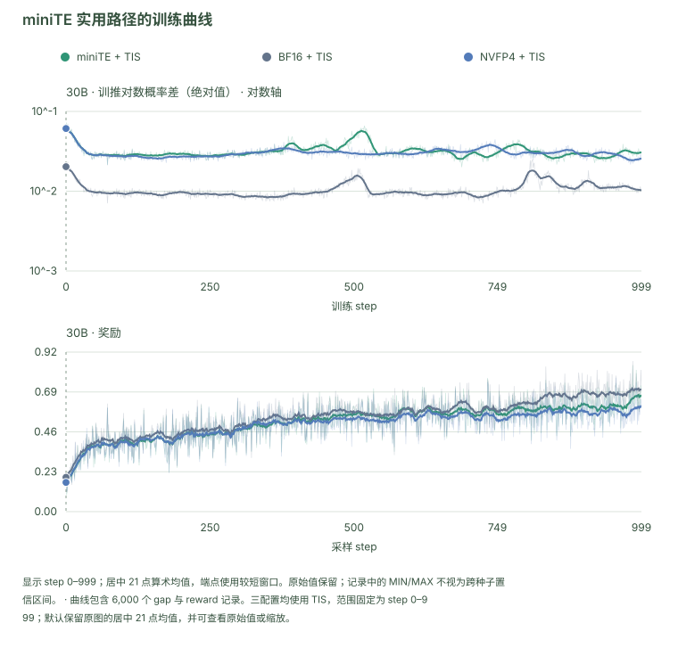

*曲线包含 6,000 个 gap 与 reward 记录。三配置均使用 TIS，范围固定为 step 0–999；默认保留原图的居中 21 点均值，并可查看原始值或缩放。*

[打开交互图：悬停查看数值、切换配置、下载 SVG / CSV](miniTE_tech_report_zh.html#figure-learning)

*图 5：miniTE 实用路径与对照的学习动态。每个配置一条运行，比较第 0–999 步；左侧为平均绝对对数概率差，右侧为奖励。细线为原始值，实线为居中的 21 步均值。三个配置均使用 TIS；该图与严格执行参考属于不同实验。*

这组补充长训使用 Qwen3-30B-A3B-Base，BF16、原生 TE NVFP4 和 miniTE 均采用 TIS，routing replay 关闭。表 6-8 给出相同第 999 步检查点的四项数学任务和 IFEval 指令遵循评估 [[11](#ref-11),[12](#ref-12),[13](#ref-13),[14](#ref-14)]。每个 AIME 评测任务平均六轮评测，MATH-500、GSM8K 和 IFEval 分别平均四轮；IFEval 使用 Prompt-level Strict accuracy。BF16 检查点使用 BF16 推理，两个 NVFP4 检查点使用 NVFP4 推理。

| 配置 | AIME24 | AIME25 | MATH-500 | GSM8K | IFEval | 五任务平均 |
| --- | --- | --- | --- | --- | --- | --- |
| BF16 + TIS | 41.11% | 31.11% | 90.05% | 93.57% | 38.36% | 58.84% |
| TE NVFP4 + TIS | 26.67% | 20.56% | 86.90% | 94.71% | 43.99% | 54.57% |
| miniTE + TIS | 36.67% | 24.44% | 87.45% | 94.79% | 38.40% | 56.35% |
| miniTE 相对 TE NVFP4 的增量 | +10.00 | +3.88 | +0.55 | +0.08 | −5.59 | +1.78 |

*表 6-8：补充长训中第 999 步检查点的任务成绩。最后一行为百分点差。五任务等权，不按评测轮数加权；重复评测同一个检查点不构成多个独立训练种子。*

miniTE 相对原生 NVFP4 改善了四项数学成绩，五任务平均提升 1.78 个百分点，与 BF16 仍相差 2.49 个百分点。IFEval 的排序不同：miniTE 与 BF16 接近，但低于原生 NVFP4。该结果支持实用数值路径在所测数学训练任务上的改善，同时表明收益并非对所有下游任务一致。

这组结果补充了框架的长期训练验证。它与第 3 节 TRIAGE 的任务集合、训练步数和评测协议不同，分别用于描述对应配置的学习效果。

<a id="section-35"></a>

### 6.3 完整训练更新：局部改动能否降低整个更新成本？

表 6-9 汇总十次独立运行的主测试，比较 BF16、TE 原生 NVFP4 和 miniTE。两条 miniTE 路径的结果同时展示反向精度选择对完整训练更新吞吐的影响。

| 配置 | token/s，十次运行截尾均值 | 相对 BF16 的配对速度比 |
| --- | --- | --- |
| TE BF16 | 24,192 | 1.000× |
| TE NVFP4 | 23,294 | 0.959× |
| miniTE CUTLASS，MXFP8 反向 | 27,607 | 1.148× |
| miniTE CUTLASS，BF16 反向 | 33,140 | 1.369× |
| miniTE per-token，BF16 反向 | 32,517 | 1.334× |

*表 6-9：完整训练更新吞吐。速度比先按运行配对再截尾，计时含前向、反向、通信、优化器和数据加载，不含采样或权重同步。*

<a id="figure-learner"></a>

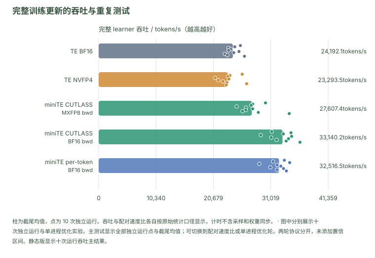

*图中分别展示十次独立运行与单进程优化实验。主测试显示全部独立运行点与截尾均值；可切换到配对速度比或单进程优化轮。两轮协议分开，未添加置信区间。静态版显示十次运行吞吐主结果。*

[打开交互图：悬停查看数值、切换配置、下载 SVG / CSV](miniTE_tech_report_zh.html#figure-learner)

两条 miniTE 路径的 BF16 反向取得约 1.33–1.37×BF16 速度，TE NVFP4 接近 BF16 量级。miniTE CUTLASS 从 MXFP8 改为 BF16 反向后进一步提高吞吐，说明更低位宽 GEMM 可能被反向量化与准备成本抵消。相对 TE NVFP4，miniTE per-token 的聚合吞吐均值比约 1.396×。1.344×是 miniTE per-token/TE BF16 聚合均值比，与这里 1.334×的配对估计量不同。

<details>
<summary>D8 · 十次独立运行、截尾统计与运行差异</summary>

| 运行 | TE BF16 | TE NVFP4 | miniTE CUTLASS MXFP8 反向 | miniTE CUTLASS BF16 反向 | miniTE per-token BF16 反向 |
| --- | --- | --- | --- | --- | --- |
| 0 | 25545.3 | 25863.2 | 30070.0 | 31196.6 | 33463.5 |
| 1 | 24530.5 | 23653.1 | 27773.2 | 34662.4 | 31416.6 |
| 2 | 23384.9 | 23291.4 | 27501.7 | 33288.5 | 34428.9 |
| 3 | 23802.7 | 20997.8 | 24865.7 | 29218.7 | 28959.3 |
| 4 | 23437.2 | 23473.3 | 26551.5 | 34777.1 | 32164.2 |
| 5 | 25292.7 | 21553.5 | 27759.3 | 31109.0 | 32828.9 |
| 6 | 24352.1 | 22381.7 | 26508.3 | 34214.7 | 30948.3 |
| 7 | 22730.2 | 23138.2 | 25925.8 | 32078.5 | 33315.1 |
| 8 | 23191.5 | 26672.6 | 28769.0 | 33794.5 | 32159.6 |
| 9 | 26277.9 | 22993.5 | 34352.4 | 36279.4 | 33835.6 |
| 截尾均值 | 24192.1 | 23293.5 | 27607.4 | 33140.2 | 32516.5 |

*表 6-10：各次运行的完整吞吐结果，显示一位小数；主文汇总显示整数。*

运行3 曾有空闲推理服务进程占用资源，其量化变体最低值按预先固定的截尾规则剔除。初期与后续 TE 版本处理零 token 专家的行为不同，非空 group 路径进行了对应检查。配置按运行编号配对，不宣称同一时刻运行。配对截尾与聚合均值相除是两个估计量，不能混用。

数据：十次运行记录；运行与版本说明。

</details>

<details>
<summary>D9 · 早期三次运行与预留显存记录</summary>

| 配置 | 早期运行 token/s | 峰值预留（原记录 MB） |
| --- | --- | --- |
| TE BF16 | 25,545 / 24,531 / 23,385 | 119,914 |
| TE NVFP4 | 25,863 / 23,653 / 23,291 | 122,672 |
| miniTE CUTLASS MXFP8 反向 | 30,070 / 27,773 / 27,502 | 144,598 |
| miniTE CUTLASS BF16 反向 | 31,197 / 34,662 / 33,289 | 137,778 |
| miniTE per-token MXFP8 反向 | 27,493（仅运行0） | 138,458 |
| miniTE per-token BF16 反向 | 33,464 / 31,417 / 34,429 | 133,398 |

*表 6-11：早期运行与其峰值预留显存，单位沿用原记录 MB；不与后续不同协议的 GiB 数值混合汇总。miniTE per-token MXFP8 反向只有单次运行参考。*

miniTE per-token 相对部分 miniTE 变体减少预留显存，但仍高于这里的 BF16。保存高精度操作数、量化权重缓存、工作区和填充都影响完整占用；FP4 位宽不是整体显存下降的充分依据。

</details>

后续完整优化链进一步连接 dense 路径、GEMM-kind、permutation fusion 和 amax 复用，miniTE per-token BF16 反向达到 33,540 token/s，即同轮 BF16 的 1.39×、TE NVFP4 的 1.47×。它是不同版本、不同协议的一轮组合测试：

<details>
<summary>D10 · 完整融合轮的全部配置与计时口径</summary>

| 配置 | 融合轮 token/s | 同轮 BF16 速度比 |
| --- | --- | --- |
| TE BF16 | 24,134 | 1.000× |
| TE NVFP4 | 22,801 | 0.945× |
| miniTE CUTLASS，MXFP8 反向 | 25,505 | 1.057× |
| miniTE CUTLASS，BF16 反向 | 33,065 | 1.370× |
| miniTE per-token，MXFP8 反向 | 26,516 | 1.099× |
| miniTE per-token，BF16 反向 | 33,540 | 1.390× |

*表 6-12：单进程优化轮，每配置一个进程；15 次测量耗时去极值求均值后换算吞吐，保留全部配置。该轮 miniTE CUTLASS MXFP8 反向为 25,505 token/s，低于独立核心测试的 27,607；协议不同，因此不把 fusion 泛化为稳定加速。*

相比核心 miniTE per-token 的 32,517 token/s，33,540 高约 3.1%，但版本、dense/GEMM 配置及 fusion 同时变化。该差值描述组合运行，不能单独归因于 amax 或 GEMM-kind。原“gemm_kind 变慢”的错误归因已在版本核查后更正。

</details>

关键结果 · §6.3两条 miniTE 路径的 BF16 反向配置取得约 1.33–1.37× BF16 的完整训练更新速度。

<a id="section-36"></a>

### 6.4 模块与实现：为什么前向更快，F+B 却未必更快？

完整训练更新已经测得收益，我们再用模块实验解释它。图 6 可切换 FC1/FC2，并选择前向、直接 F+B 或二者叠加；F+B 使用直接计时结果：

<a id="figure-trend"></a>

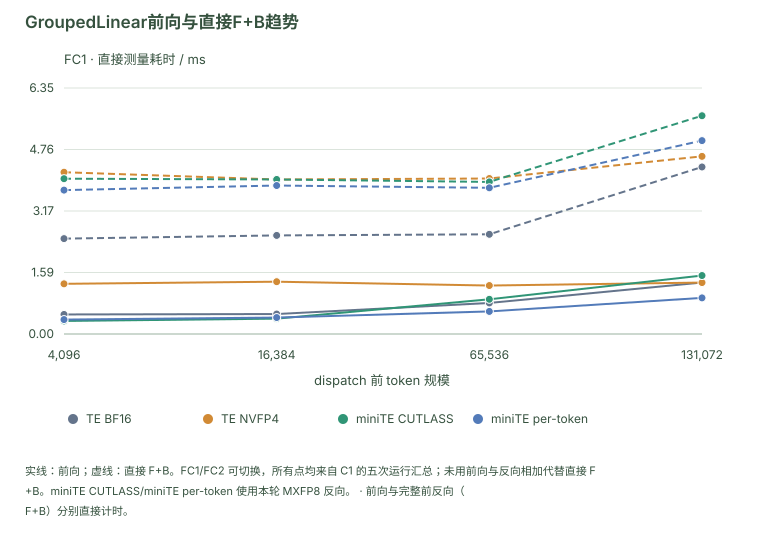

*前向与完整前反向（F+B）分别直接计时。*

[打开交互图：悬停查看数值、切换配置、下载 SVG / CSV](miniTE_tech_report_zh.html#figure-trend)

*图 6：Qwen3-30B-A3B GroupedLinear，B300、预热静态权重、五次运行。实线为前向，虚线为直接 F+B；图中两条 miniTE 路径使用本轮量化反向。横轴是 dispatch 前 token 规模，不能把该均衡负载等同于完整模型路由。*

miniTE per-token 相对 BF16 前向约快 1.09–1.43×，图中的 F+B 却慢于 BF16。开启 BF16 反向后，miniTE per-token 相对自身 MXFP8 反向的 F+B 约快 1.2–1.3×。因此，反向精度应根据完整算子的实测成本选择。

<a id="figure-module"></a>

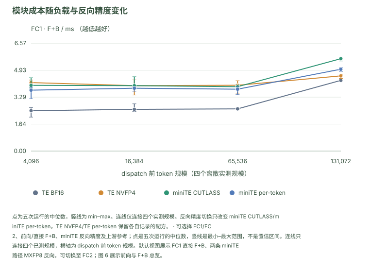

*可选择 FC1/FC2、前向/直接 F+B、miniTE 反向精度及上游参考；点是五次运行的中位数，竖线是最小–最大范围，不是置信区间。连线只连接四个已测规模，横轴为 dispatch 前 token 规模。默认视图展示 FC1 直接 F+B、两条 miniTE 路径 MXFP8 反向，可切换至 FC2；图 6 展示前向与 F+B 总览。*

[打开交互图：悬停查看数值、切换配置、下载 SVG / CSV](miniTE_tech_report_zh.html#figure-module)

<details>
<summary>D11 · FC1/FC2 × 4 种规模：前向与直接 F+B 完整毫秒表</summary>

<a id="section-37"></a>

#### 前向

| 模块 | 配置 | 测量 | 4k ms | 16k ms | 64k ms | 128k ms |
| --- | --- | --- | --- | --- | --- | --- |
| FC1 | TE BF16 | 前向 | 0.504 | 0.515 | 0.801 | 1.329 |
| FC1 | TE NVFP4 | 前向 | 1.295 | 1.349 | 1.250 | 1.327 |
| FC1 | miniTE CUTLASS | 前向 | 0.336 | 0.396 | 0.895 | 1.508 |
| FC1 | miniTE per-token | 前向 | 0.372 | 0.424 | 0.582 | 0.932 |
| FC2 | TE BF16 | 前向 | 0.542 | 0.508 | 0.546 | 0.820 |
| FC2 | TE NVFP4 | 前向 | 1.428 | 1.190 | 1.281 | 1.244 |
| FC2 | miniTE CUTLASS | 前向 | 0.339 | 0.355 | 0.677 | 1.111 |
| FC2 | miniTE per-token | 前向 | 0.389 | 0.415 | 0.565 | 0.753 |

<a id="section-38"></a>

#### MXFP8 反向对应的直接 F+B

| 模块 | 配置 | 测量 | 4k ms | 16k ms | 64k ms | 128k ms |
| --- | --- | --- | --- | --- | --- | --- |
| FC1 | TE BF16 | fwb | 2.461 | 2.543 | 2.572 | 4.309 |
| FC1 | TE NVFP4 | fwb | 4.174 | 3.986 | 4.011 | 4.583 |
| FC1 | miniTE CUTLASS | fwb | 4.006 | 3.987 | 3.923 | 5.631 |
| FC1 | miniTE per-token | fwb | 3.712 | 3.830 | 3.771 | 4.989 |
| FC2 | TE BF16 | fwb | 2.959 | 2.994 | 2.933 | 4.592 |
| FC2 | TE NVFP4 | fwb | 4.604 | 4.790 | 4.802 | 5.414 |
| FC2 | miniTE CUTLASS | fwb | 4.147 | 3.916 | 3.881 | 5.417 |
| FC2 | miniTE per-token | fwb | 3.875 | 3.915 | 3.907 | 5.056 |

<a id="section-39"></a>

#### BF16 反向对应的直接 F+B

| 模块 | 配置 | 测量 | 4k ms | 16k ms | 64k ms | 128k ms |
| --- | --- | --- | --- | --- | --- | --- |
| FC1 | miniTE CUTLASS | fwb | 2.975 | 2.966 | 3.253 | 5.473 |
| FC1 | miniTE per-token | fwb | 2.964 | 2.992 | 3.018 | 4.869 |
| FC2 | miniTE CUTLASS | fwb | 2.908 | 2.913 | 2.958 | 4.936 |
| FC2 | miniTE per-token | fwb | 3.158 | 2.943 | 3.088 | 4.636 |

*表 6-13：各配置对应的五次运行的中位数，保留三位小数。不同反向表不混合；TE BF16/TE NVFP4 没有该 BF16 反向补测行时显示在原配置表。*

| 配置 | TE BF16 | TE NVFP4 | miniTE CUTLASS | miniTE per-token |
| --- | --- | --- | --- | --- |
| 128k FC1 峰值预留 GiB | 7.39 | 6.91 | 8.65 | 8.76 |

*这里的显存占用在模块测试中测量，受计时方式和权重缓存设置影响；训练端峰值显存另行统计。*

原始数据：主模块记录、BF16反向记录。

</details>

<details>
<summary>D12 · miniTE per-token 对 TE 原生 NVFP4 的模块速度比</summary>

| 模块 | 模式 | 4k | 16k | 64k | 128k |
| --- | --- | --- | --- | --- | --- |
| FC1 | 前向 | 3.48x | 3.18x | 2.15x | 1.42x |
| FC1 | F+B | 1.12x | 1.04x | 1.06x | 0.92x |
| FC2 | 前向 | 3.67x | 2.87x | 2.27x | 1.65x |
| FC2 | F+B | 1.19x | 1.22x | 1.23x | 1.07x |

*表 6-14：miniTE per-token/TE NVFP4 的对应配置速度比，>1 表示 miniTE per-token 更快。F+B 使用各自记录的反向路径；128k FC1 处并非所有比较都领先。*

</details>

固定相同前向精度配方后，miniTE per-token 对上游 TE per-token 的专家层前向几何平均为 2.46×，直接 F+B 为 1.10×。两者差距提示实现收益主要在前向调用和准备链。输入在计时前完成置换，FC2 激活也在计时区间外准备；模块计时不包含 token 分发。

<details>
<summary>D13 · miniTE per-token/TE per-token 的逐锚点实现增量和 amax 消融</summary>

| 模块 | 模式 | 锚点 | TE per-token | miniTE per-token | miniTE per-token speedup |
| --- | --- | --- | --- | --- | --- |
| FC1 | 前向 | 4k / 16k / 64k / 128k | 1.128 / 1.094 / 1.275 / 1.479 | 0.372 / 0.424 / 0.582 / 0.932 | **3.03x / 2.58x / 2.19x / 1.59x** |
| FC1 | F+B | 4k / 16k / 64k / 128k | 3.873 / 3.916 / 3.846 / 5.066 | 3.712 / 3.830 / 3.771 / 4.989 | 1.04x / 1.02x / 1.02x / 1.02x |
| FC2 | 前向 | 4k / 16k / 64k / 128k | 1.193 / 1.043 / 1.555 / 1.747 | 0.389 / 0.415 / 0.565 / 0.753 | **3.06x / 2.52x / 2.75x / 2.32x** |
| FC2 | F+B | 4k / 16k / 64k / 128k | 4.603 / 4.507 / 4.488 / 6.234 | 3.875 / 3.915 / 3.907 / 5.056 | 1.19x / 1.15x / 1.15x / 1.23x |

*表 6-15：模块延迟和速度比，五次运行。数值等价检查固定前向精度配方；环境与反向设置见本节实验配置。*

Amax skip-K1 模拟在多数规模持平或略慢，范围约 0.81–1.11×。这一模拟未计 producer 收益，也保留准备开销，不能由它单独否定或证明完整 producer–consumer 融合。Dense 布局与其他优化组合测量，其单独贡献尚无对应消融。

| module | mode | 锚点 | miniTE per-token amax off | miniTE per-token amax on | on vs off |
| --- | --- | --- | --- | --- | --- |
| fc1 | 前向 | 4k | 0.372 | 0.459 | 0.81x |
| fc1 | 前向 | 16k | 0.4241 | 0.4586 | 0.925x |
| fc1 | 前向 | 64k | 0.5823 | 0.6166 | 0.944x |
| fc1 | 前向 | 128k | 0.9319 | 0.8365 | 1.114x |
| fc1 | fwb | 4k | 3.7122 | 3.8659 | 0.96x |
| fc1 | fwb | 16k | 3.8303 | 3.8542 | 0.994x |
| fc1 | fwb | 64k | 3.7713 | 3.8175 | 0.988x |
| fc1 | fwb | 128k | 4.9888 | 4.9196 | 1.014x |
| fc2 | 前向 | 4k | 0.3894 | 0.4017 | 0.969x |
| fc2 | 前向 | 16k | 0.4145 | 0.4407 | 0.941x |
| fc2 | 前向 | 64k | 0.5655 | 0.5927 | 0.954x |
| fc2 | 前向 | 128k | 0.7534 | 0.7842 | 0.961x |
| fc2 | fwb | 4k | 3.8746 | 3.9556 | 0.98x |
| fc2 | fwb | 16k | 3.9151 | 3.995 | 0.98x |
| fc2 | fwb | 64k | 3.9069 | 3.8958 | 1.003x |
| fc2 | fwb | 128k | 5.0562 | 5.1263 | 0.986x |

*表 6-15b：miniTE per-token 模块级 skip-K1 模拟。统计量来自对应模块测试；producer 收益不计入此表。*

数据及原始运行：模块消融记录。

</details>

<details>
<summary>D14 · 上游 TE per-token 完整模型计时：保留数据与配置边界</summary>

| 配置 | tokens/s（3 trials） | paired speedup vs TE per-token | max 预留 (MB) |
| --- | --- | --- | --- |
| TE per-token | 23125 / 23150 / 22346 | — | 122572 |
| TE BF16 | 25545 / 24531 / 23385 | 1.06x | 119914 |
| TE NVFP4 | 25863 / 23653 / 23291 | 1.04x | 122672 |
| miniTE per-token (mxfp8-bwd) | 27493（运行0 参考） | 1.19x（运行0 配对） | 138458 |
| **miniTE per-token (bf16-bwd)** | **33464 / 31417 / 34429** | **1.45x** | 133398 |

*表 6-16：三次运行的完整模型对照。约 1.45×是这两套配置的计时比，不是固定精度配置下的纯实现收益。*

TE per-token 量化范围覆盖非专家层，反向为其原生 NVFP4 per-token；miniTE per-token 为仅量化专家层，分别采用 MXFP8/BF16 反向。TE per-token 测试还记录 grad norm 约 1e8–1e11，clipping 后实际更新很小。计时与学习行为一起保留，不能把这行速度比包装为等价学习路径的收益。

详见TE per-token完整模型记录。

</details>

性能分析结果解释了局部到整体的变化：host 参数准备、分组调用间隙、专家通信与非 GEMM 运算共同影响更新时间。连续布局减少了计算周围的组织工作，模型测试则计入真实路由和外围成本。

<details>
<summary>D15 · 代表性 profile：多 tensor 调用与 grouped GEMM 路径</summary>

**Dispatch/路由对下游 GEMM 调度的影响。** 在补充记录的 Step 8 第一个 microbatch 中，真实权重与真实输入的路由较均匀，随机权重与随机输入的 mock 路由则高度集中。两者每 rank 都输入 4,096 tokens、top-k=8，EP 组内 routed tokens 均为 131,072，因此这里先比较相同 token 预算下的专家分布：

| 负载指标 | Real | Mock | 解释 |
| --- | --- | --- | --- |
| 有 token 的 experts | 126/128 | 24/128 | Mock 的 token 集中到少数专家 |
| 零 token experts | 2 | 104 | 参与计算的专家数不同 |
| GroupedLinear M 的 CV | 0.19 | 0.66 | 记录中的 Real GEMM 行数分布更均匀 |

`M` 是专家 GEMM 的 token 行数，CV 表示同一统计口径下的标准差与均值之比；这里沿用记录中的 GroupedLinear M 统计，不从全局专家计数倒推 CV。参与计算的专家更多，会形成更多需要准备和调度的矩阵乘法问题；这部分开销需要结合 host API 与 kernel 的 profile 观察：

| 调用指标 | Real | Mock | 解释 |
| --- | --- | --- | --- |
| cuBLASLt heuristic 次数 / 累计时间 | 14.8 万 / 6.26 s | 3.2 万 / 1.02 s | Real 调用次数约为 4.6× |
| heuristic 单次中位耗时 | 2.9 µs | 2.9 µs | 单次中位数接近，调用数量差异明显 |
| nvte_multi_tensor_gemm 次数 / 中位耗时 | 4,608 / 2.29 ms | 4,590 / 0.44 ms | 调用数接近，Real 中位耗时约为 5.2× |
| nvjet kernel 次数 | 11.4 万 | 0.46 万 | Real 约为 25× |

第一张表定位到该 microbatch 的路由负载，第二张表保留配套 profile 的调用计数、累计时间与单次中位耗时；累计时间不解释为这一个 microbatch 的墙钟时间，也不与 GPU kernel 时间直接相加。

**相同 token 预算被拆成更多 GEMM 问题。** 对相同的专家矩阵形状，主要 GEMM 算术量随各专家 token 行数之和变化。Real 的 token 总量与 Mock 相同，却分布在 126 个活跃专家上，而 Mock 只有 24 个，因此 Real 的单专家平均 M 更小，有效问题条目更多。较低的 CV 说明这些问题之间更均衡，但算法准备和调度还取决于问题数量与粒度。许多较小 GEMM 更难摊薄每个问题的固定准备、启动成本。

**cuBLASLt 算法选择在 host 侧反复执行。** 原 profile 记录将 BF16 的主要瓶颈定位到 `AlgoGetHeuristic`：多 stream 的 multi-tensor 路径仍会多次执行算法选择，同时准备各专家的形状、布局和调用参数。表中 heuristic 单次中位数都为 2.9 µs，Real 的调用次数却约为 Mock 的 4.6×，说明额外代价主要来自这项工作的重复规模。外层 `nvte_multi_tensor_gemm` 调用次数接近，但一次调用内部处理的专家问题与准备工作不同，因而 Real 的调用中位耗时达到 2.29 ms，约为 Mock 的 5.2×。

**更多细粒度 kernel 使提交链更长。** Real 的 `nvjet` kernel 次数约为 Mock 的 25×，表明同一 token 预算对应的 GPU 调用组织不同。若 CPU 端的算法选择、参数准备和启动提交成为瓶颈，增加 stream 数量也难以掩盖 GPU 等待下一批任务的间隙，这就是该路径中需要关注的 CPU bubble。这里的计数直接支持重复准备和调度负担增大；GPU 空档具体占多少时间，仍需由对应时间线量化。

**Dense grouped GEMM 针对的是这段准备与调度链。** 第 5 节的连续 buffer、device 侧 offset/metadata 和预分配复用，让多个专家问题沿统一的 grouped 调度路径执行，减少 host 上逐专家切分、拼列表、参数构建及重复组织的工作。它既影响 GEMM 周围的开销，也影响完整调用时间，因此图中的差异应结合实现路径来理解。实际收益仍采用同口径的模块或 learner 计时；BF16 与低精度方案的比较都应以真实权重和真实路由负载为准。

<a id="figure-te-profile"></a>

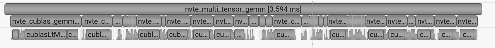

*性能分析截图*

<a id="figure-nvfp4-profile"></a>

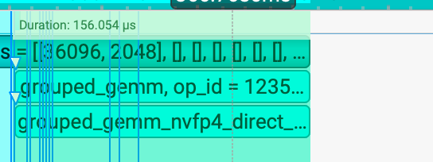

*性能分析截图*

*图 7：代表性的性能分析片段，用于观察调用组织；两张截图自身未提供相同形状、同一 timer 的配对协议，不用 3.594 ms 与 156µs 相除报告速度比。完整速度采用上述模块/训练端测试。*

</details>

<a id="section-40"></a>

### 6.5 采样与在线 RL：哪里出现系统收益，哪里仍有成本？

采样端先在固定输出工作量上测容量。八个推理实例使用 DAPO 真实 prompt，输出固定 1024 token 且忽略 EOS，两种配置分别扫描 concurrency 后都选择 64：

| 配置 | 聚合输出 token/s | 平均 TPOT | 吞吐比 |
| --- | --- | --- | --- |
| BF16 | 49,119.1 | 10.21 ms | 1.000× |
| NVFP4 | 80,675.8 | 6.05 ms | 1.642× |

*表 6-17：固定输出推理服务，BF16 为 Triton MoE，NVFP4 为 FlashInfer TRT-LLM/ModelOpt FP4 及 per-token scaling。它描述对应采样栈，不隔离 miniTE 训练算子的贡献。*

<a id="figure-serving"></a>

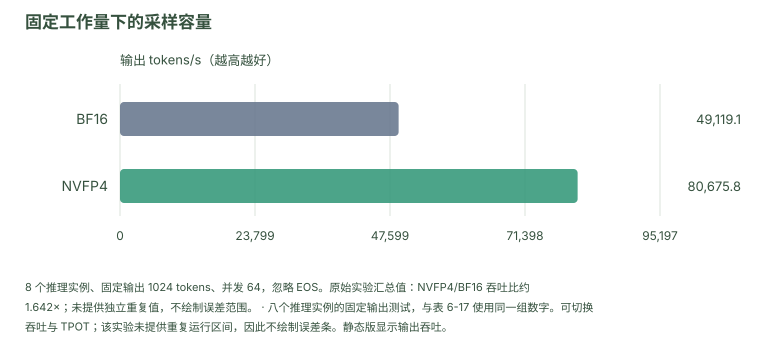

*八个推理实例的固定输出测试，与表 6-17 使用同一组数字。可切换吞吐与 TPOT；该实验未提供重复运行区间，因此不绘制误差条。静态版显示输出吞吐。*

[打开交互图：悬停查看数值、切换配置、下载 SVG / CSV](miniTE_tech_report_zh.html#figure-serving)

<details>
<summary>D16 · 八推理实例请求率、单推理实例吞吐和推理服务协议</summary>

| variant | BEST **concurrency** | final sum out tok/s | mean out / 推理实例 | sum req/s | mean TPOT | vs peer |
| --- | --- | --- | --- | --- | --- | --- |
| **NVFP4** | 64 | **80675.8** | 10084.5 | 78.78 | 6.05 ms | **1.64×** vs BF16 |
| **BF16** | 64 | **49119.1** | 6139.9 | 47.97 | 10.21 ms | baseline |

*表 6-18：完整推理服务结果。固定输出下 req/s 与 output token/s 对应同一工作量。*

静态显存比例为 0.6，关闭分段 CUDA Graph；使用对话模板，不填充输入，不限制请求速率，并清空缓存，上下文长度上限为 8192。先用 64 条提示词在单个推理实例上扫描 1–96 的并发数，再以选定的并发数 64 在八个实例上运行 512 条提示词。单实例扫描峰值约为 NVFP4 10206.8、BF16 6063.5 token/s；八实例聚合吞吐作为主结果。

</details>

完整 RL 还需要把训练端和权重更新连接到生成。对于无重叠的顺序流程，

$$
T_{\mathrm{iter}}=
T_{\mathrm{rollout}}+T_{\mathrm{learner}}+
T_{\mathrm{convert+sync}}+T_{\mathrm{orchestration}}.
$$

存在重叠时以实测 wall time 为准。表 6-19 恢复 BF16、TE 原生 NVFP4 及 miniTE per-token 三个配置的已记录阶段：

| 配置 | 稳态步数 | Train s | 转换/同步 s | 两阶段合计 s |
| --- | --- | --- | --- | --- |
| BF16 | 11 | 47.04 | 9.94 | 56.98 |
| TE NVFP4 | 10 | 44.70 | 50.88 | 95.58 |
| miniTE per-token，BF16 反向 | 10 | 42.56 | 55.26 | 97.82 |

*表 6-19：在线 RL 的阶段均值。Train 含对数概率重算与 actor train；两阶段合计不是完整 iteration。TE NVFP4 使用其原生反向配置，miniTE per-token 显式关闭反向量化。*

<a id="figure-rl-cost"></a>

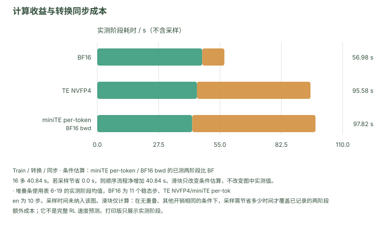

*堆叠条使用表 6-19 的实测阶段均值，BF16 为 11 个稳态步、TE NVFP4/miniTE per-token 为 10 步。采样时间未纳入该图。滑块仅计算：在无重叠、其他开销相同的条件下，采样需节省多少时间才覆盖已记录的两阶段额外成本；它不是完整 RL 速度预测。打印版只展示实测阶段。*

[打开交互图：悬停查看数值、切换配置、下载 SVG / CSV](miniTE_tech_report_zh.html#figure-rl-cost)

miniTE per-token 的 Train 相对 BF16 约快 1.11×，TE NVFP4 约快 1.05×；转换/同步却分别约慢 5.56×和 5.12×。miniTE per-token 的两阶段成本增加 40.84 秒。本次实验中，采样提速未能抵消同步成本，因此后续优化需要同时减少转换和传输开销。

这组结果保留了一个有用的负面发现：低精度算子更快，不保证系统连接成本更低。独立推理服务比值不能替代同运行窗口的采样时间，两阶段相加也不能生成完整 RL 速度比。

<details>
<summary>D17 · 三组 RL 配置、样本窗口与相对速度</summary>

公共配置为单节点 8×B300 共置部署、每采样端推理实例一张 GPU。丢弃 perf id0–1；BF16 取 steps2–12（11 步），miniTE per-token/TE NVFP4 取各自 steps2–11（10 步），采用算术均值。

| 配置 | Train 相对 BF16 速度 | 同步时间/BF16 同步时间 | 前向/采样 | 反向 |
| --- | --- | --- | --- | --- |
| BF16 | 1.000× | 1.000× | BF16，Triton MoE | BF16 |
| TE NVFP4 | 1.052× | 5.119× | TE native 专家 NVFP4；ModelOpt/FlashInfer 采样端 | 原生精度配方，未设置 DBQ |
| miniTE per-token | 1.105× | 5.559× | miniTE 专家 per-token；同 NVFP4 采样端 | DBQ=1，BF16 |

*表 6-20：时间比的方向明确。旧表中的 0.90×是 miniTE per-token/BF16 的 Train 时间比，其速度比为倒数；不能当作整轮 RL 速度。TE NVFP4 与 miniTE per-token 采用同类 NVFP4 采样配置，未重复测量同一推理服务表。*

</details>

关键结果 · §6.5八推理实例固定输出测试中，miniTE per-token 吞吐约为 BF16 的 1.64×。

<a id="section-41"></a>

### 6.6 实验如何回答主线问题

这些实验共同解释了 miniTE 的实现选择。算子与梯度检查支撑接口、布局和反向精度的选择；模块前向与完整前反向计时定位局部开销；真实文本训练验证这些选择能否降低完整更新成本；推理服务与在线 RL 测试进一步揭示权重转换和同步的约束。

低比特训练的收益因此需要在多个层次验证：数值正确、持续有效学习、局部计算更快，以及系统连接成本可控。本文保留各层的核心数据和完整配置对照，性能结果统一采用 miniTE 测试记录。

<a id="section-42"></a>

## 7. 使用与扩展 miniTE

<a id="section-43"></a>

### 7.1 通过线性层接口接入现有模型

miniTE 的工程包名为 `miniTransformer`，基本接入单位是线性层。`Linear`、`LayerNormLinear` 和 `GroupedLinear` 分别面向普通投影、归一化与线性层组合，以及 MoE 专家计算。现有 Megatron 包装类可以连接相应模块，也可直接向层传入具名配方生成的参数：

```python
import torch
from miniTransformer.module.config import get_qlinear_params
from miniTransformer.module.linear import Linear

params = get_qlinear_params("nvfp4_per_token")
layer = Linear(
    1024, 1024,
    bias=False,
    params_dtype=torch.bfloat16,
    device="cuda",
    qlinear_params=params,
)
```

选择配方决定数值路径，模块替换决定模型中哪些层使用 miniTE。MoE 启动脚本为对应 backend 同时设置这两项。当前 `GroupedLinear` 对输出维度与分组数据布局有约束，且不支持 sequence parallelism；接入时应检查具体模型和并行配置。

miniTE 保留面向 TE/Megatron 检查点的参数命名与兼容接口。当前 extra-state 接口不恢复 TE 的全部内部量化状态，因此参数加载兼容与完整内部状态兼容需要分别验证。

<a id="section-44"></a>

### 7.2 显式选择精度配方与精度边界

v1.0.0 使用描述数值行为的配方名称。用户可通过 `MINITE_RECIPE` 选择训练程序的配方，也可使用 `get_qlinear_params` 构造独立配置和算子实例：

| 具名配方 | 前向与缩放 | 反向及用途 |
| --- | --- | --- |
| `nvfp4_per_token` | NVFP4 per-token；TE 权重缩放 | MXFP8 反向；首次使用示例 |
| `nvfp4_per_token_bf16_bwd` | NVFP4 per-token | 专用 TE-style BF16 反向算子 |
| `nvfp4_cursor2_cutlass_v2` | 激活 per-token，权重 per-expert tensor amax；CUTLASS V2 | MXFP8 反向；自研 grouped 路径 |
| `nvfp4_block` | NVFP4 block scaling | NVFP4 反向；块缩放配方 |
| `nvfp4_per_token_w_per_tensor` | per-token 激活与 per-expert tensor weight amax | 权重缩放消融 |
| `unquantized` | 实际 dtype 由层参数决定 | 关闭量化，用于高精度对照 |

*表 9：v1.0.0 的部分具名配置入口。性能实验仍沿用其源码 revision、前后向精度和量化覆盖；配方名称用于当前软件的选择。*

在已接入的训练程序中，可以显式选择：

```bash
MINITE_RECIPE=nvfp4_per_token python train.py
```

这里 `train.py` 表示用户自己的训练入口。按当前命名方式表达报告中 miniTE per-token 的 BF16 layer bypass 路径时，训练端的选择为：

```bash
MINITE_RECIPE=nvfp4_per_token DISABLE_BACKWARD_QUANT=1 python train.py
```

这一 layer bypass 与 `nvfp4_per_token_bf16_bwd` 的专用反向算子分别实现和记录。第 6 节两条 miniTE 路径的速度结果对应原实验路径；专用算子的性能需要使用它自身的测量。重现历史实验时，还应使用原 revision 的启动配置，并固定采样端量化、检查点转换、仅量化专家层范围与 TE revision。

<a id="section-45"></a>

### 7.3 将诊断能力作为扩展过程的一部分

配置检查从运行模型前开始。以下命令在 `miniTransformer` 仓库根目录执行：

```bash
python -m miniTransformer recipes
python -m miniTransformer describe nvfp4_per_token
python -m miniTransformer doctor --recipe nvfp4_per_token
bash develop/script/moe_training_e2e.sh \
  --backend mini_nvfp4_per_token --profile off --dry-run
```

`recipes` 与 `describe` 无需安装 Torch 或 TE，即可查看名称、依赖和当前反向覆盖。`doctor` 检查可见 CUDA GPU、TE quantizer 参数、所选 dense/list 分组接口及算子导入。`--dry-run` 显示配方、相关环境变量和完整启动命令后退出，不启动训练或创建日志与缓存目录。正常运行将配方名称、前后向设置、布局请求和配置来源写入 `run_meta.json`。

本轮配置入口的 21 项 CPU 兼容检查覆盖解析、配置冲突、无 GPU 依赖查询、启动别名、dry-run 和元数据记录，均已通过。新增的 GPU 等价测试覆盖配置实例独立性、支持路径上的 Dense/GroupedLinear 前后向，以及两种 BF16 反向选择；本轮本机尚未执行这些测试。第 6 节的数值与性能结果保留其原实验身份。

扩展低精度路径时，我们先检查单算子输出，再检查模块和跨端结果，最后运行完整训练。数值钩子采集激活、权重、输出和梯度；性能工具定位内核、调用间隙和分配；dump/compare 脚本比较 MoE 中间量与 token 对数概率。新配方在注册表中说明用途与依赖，在现有参数工厂中接入算子，再沿这条流程检查数值行为和运行成本。

构建、模块接入与启动示例由仓库 README 承接，双语配方手册提供完整选择与覆盖规则。模型转换、采样和评测需固定各自的版本与运行条件；当前软件入口和历史实验配置分别记录。

<a id="section-46"></a>

## 8. 讨论：从数值对齐走向端到端学习

前面的实验沿算法和工程两条线处理低精度 RL：TRIAGE 调整存在失配时的更新，miniTE 减少执行差异并降低计算成本。这两条路线还没有解决全部问题。下一步需要同时回答：省下的算力能否变成端到端收益，以及更一致的计算能否带来更好的学习。

<a id="section-47"></a>

### 8.1 权重更新与同步仍是关键瓶颈

这里的 `update weight` 指把训练后的权重转换、传输并加载到采样端。它仍是本报告所测配置中压低端到端收益的核心瓶颈：训练更新和采样分别提速，并不意味着完整 RL 迭代按相同比例提速。第 6.5 节中，转换与同步成本已经抵消了该轮采样提速带来的收益。

后续应把训练端和采样端的参数表示、量化与打包、传输、加载以及同步频率放在一起优化。可探索在同一权重版本内复用已经生成的低精度表示、合并转换与传输，以及在版本管理明确的条件下重叠同步和采样。降低同步频率可能节省传输，却会增加策略滞后；这些选择应以完整迭代耗时和同等训练预算下的任务表现共同衡量。Online amax 与更深的算子融合也需要在这一端到端范围内评估。

<a id="section-48"></a>

### 8.2 对齐算子之后，低精度为何仍更敏感？

统一算子和量化配方能消除一部分执行差异，但仅有相同的算子名称，并不保证所有输入形状、批次和并行配置下的浮点计算都一致。浮点加法不满足结合律，归约顺序、融合边界或分块方式变化都可能改变结果。固定执行路径可以做到确定性复现；需要继续研究的是，当这些执行条件变化时，扰动会在哪里产生，又如何进入后续更新。

本报告的对齐实验与长期评测分别揭示了这个问题的两面：严格对齐配置把 gap 降到了约 10⁻⁸，而 miniTE 的长期学习与检查点评测仍未在所有比较中追平 BF16。两组结果的配置和测量范围不同，但它们共同说明，数值一致性和最终学习质量需要分别验证。我们仍需解释：为什么在所测低精度配置中，看似很小的扰动更容易破坏学习？

值得检查的机制包括误差的持续偏置、粗量化网格附近的舍入跳变、MoE 路由变化，以及梯度裁剪和优化器状态对这些误差的累积响应。它们目前是待检验的解释。更有辨识力的实验应固定模型与数据，控制扰动的位置、方向和相关性，在 BF16 与低精度下比较后续更新及长程奖励，而不只比较单步平均 gap。

<a id="section-49"></a>

### 8.3 从更新规则和最终效果出发优化

平均 logp diff 不能线性换算为 reward。相似的平均差异可能出现在不同 token、优势值符号和响应片段上，对更新的作用也不同；小 gap 同样不能保证有效的探索和梯度信号。TRIAGE 的方向分析是一个切入点。下一步可以直接研究误差如何改变更新，并用同等数据、更新预算和墙钟预算下的奖励与评测成绩检验修正是否有效。

社区的解法也在拓宽。Together AI 的 Score Centering（SC）通过加性修正消除策略梯度中由训推差异引入的漂移，可与重要性采样组合 [[17](#ref-17)]。Qwen 团队的 TRACE 用采样端的量化结果指导训练端的 FP4 舍入，并压缩保存所需的量化信息 [[18](#ref-18)]。前者修改梯度估计，后者协调两端的量化决策；TRACE 仍以对齐为目标，但两者都说明，可干预的位置已超出统一算子实现。

对 miniTE 而言，这意味着除了继续提供可控、可比较的数值执行，还应支持更新规则、精度分配和采样策略的联合实验。我们希望社区进一步研究的，是如何保留与任务有关的学习信号、抑制会随更新累积的偏差，并把这些改进转化为真实的端到端收益。最终目标是让低精度 RL 在给定资源内学得更好，而不只是让某一个一致性指标更小。

<a id="section-50"></a>

## 附录 A. 实验设置与统计方法

<a id="section-51"></a>

### A.1 补充算法与训练资料

TRIAGE 的方法与效果以 TRIAGE 待发布主稿及其诊断附录为依据。算法结果采用表 3 所列检查点，五项数学评测任务等权平均；4B 的新版结果为 BF16 58.26%、TRIAGE 58.49%，共同第 300 步的 TRIAGE 为 53.03%。

Characterization 是独立诊断运行：4B 分析 updates 1–324，30B 分析 updates 1–724；最大 completion 分别为 16,384 和 20,480。4B 测量直接训练端–采样端 gap，30B 使用 routing replay 后的残余 gap。健康阶段全部有效 token 的固定尾部阈值分别为 −0.24208 和 −0.03949。

诊断运行使用 DAPO-Math-17K，训练端随机种子为 1234、采样与数据随机种子为 42；每轮 16 个 prompt、每 prompt 16 条响应，GBS 为 256。它们使用 RHT 和梯度随机舍入，相关数值设置不能套用到关闭这些选项的 miniTE 实用路径。详细窗口、长度敏感性、一步更新审计及随机化控制见上述附录。

TRIAGE 的材料在此仅用于算法与效果。该镜像未按 miniTE 性能测试进行同等精调，因此其吞吐不能作为 miniTE 性能上限或算法开销的对照，本文不引用其吞吐结果。

<a id="section-52"></a>

### A.2 长期 RL 与检查点评测补充

miniTE论文附录整理了图 5 与表 6-8 对应的配置和评测协议：

| 项目 | 设置 |
| --- | --- |
| 模型与数据 | Qwen3-30B-A3B-Base；DAPO-Math-17K，math 奖励 |
| 训练目标 | GRPO；非严格配置均使用 token-wise TIS |
| 随机性 | Training seed 1234；采样 shuffle seed 42 |
| Batch | 每轮 32 个 prompt，各 16 条响应；GBS 512 |
| 生成 | Temperature 1.0，top-p 1.0，top-k 禁用，最大响应 20,480 |
| 并行与分配 | 8 节点、每节点 8 actor GPU；TP/PP/CP/EP/ETP = 1/1/1/4/1；actor/采样端共置部署 |
| 优化器 | Adam，学习率 $10^{-6}$，无 warmup；weight decay 0.1，$\beta_1=0.9,\beta_2=0.98,\epsilon=10^{-8}$，gradient clipping 1.0 |
| 内存策略 | 全激活重计算、动态微批次；分布式 precision-aware 优化器、CPU offload 与重叠传输 |
| TIS 与裁剪 | Token-wise TIS 权重截于 [0,2]；policy update ratio 边界 [0.80,1.28]；routing replay 关闭 |
| 评测 | Step 999；temperature 0.7，top-p 1.0，最大生成长度 20,480 |
| 重复与指标 | AIME 各六轮；MATH-500、GSM8K、IFEval 各四轮；IFEval 为 Prompt-level Strict |

*表 A1：miniTE 补充长训的协议。它与单节点 8×B300 的固定文本训练端测试采用不同的实验配置。重复检查点评测不增加训练种子数。*

三个主训练配置比较第 0–999 步，每配置一条曲线，叠加居中的 21 步均值。正文图 4 采用 四面板图及 15 步平滑；配套论文另整理了同类对齐实验的两面板 21 步平滑版本，二者图注不混用。该严格对齐配置联合改变多个执行组件并移除 TIS，与训练端性能测试分别计时。

<a id="section-53"></a>

### A.3 miniTE 的固定文本训练测试

| 项目 | 设置 |
| --- | --- |
| 模型与设备 | Qwen3-30B-A3B，单节点 8×B300 |
| 并行与形状 | TP/PP/CP/EP = 1/1/1/4；sequence 4096；微批次 1；GBS 128 |
| 工作量 | 每更新 524,288 token；16 个累积微批次 |
| 数据与起点 | 冻结的 657 条 4097-token DAPO 文本序列；同一 BF16 检查点；seed 20260913 |
| 主要软件 | PyTorch 2.11.0+cu130，CUDA 13.0.88，NCCL 2.28.9，Megatron-Core 0.16.0rc0 |
| Megatron | Revision `52153937`，实验所需集成补丁 |
| 核心版 | miniTE `953f17f9`；十次独立进程运行，未融合 permutation |
| 优化版 | miniTE `b641179`；dense、GEMM-kind、permutation fusion 与 amax 复用 |
| TE | 初期 `eaca54e9`，后续 `8ea5a92d` 处理零 token 专家；非空 group 路径检查一致性 |
| TE per-token | `690ffea4` 加 CUDA 13 编译兼容修正，独立环境 |

*表 A2：固定文本性能协议。数据构建约有 4.3 倍重复；激活重计算、offload 和 CUDA graph 关闭。量化路径的专家填充成本纳入计时。*

核心版每进程运行 20 次更新，前五次预热，updates 6–15 构成测量窗口。每次运行的吞吐由 524,288 除以中位更新耗时得到。跨十次运行去掉一个最大值和一个最小值后平均；配对速度比也按运行编号先计算，再按同样方式截尾。

优化版每配置一个进程，17 次更新中前两次预热，其余 15 次 update 耗时去掉最大和最小后平均，再用 524,288 tokens 除以该平均耗时换算吞吐；速度比采用同轮基线。两类估计量分组报告。核心运行 3 存在空闲推理服务进程干扰，相关最小观测按既定截尾规则剔除；全部十次记录及版本差异保留在 miniTE 测试汇总中。

表 6-9 使用十次独立运行的配对速度比。1.334×是各次运行速度比经截尾后的均值，1.344×是聚合吞吐均值之比；两者的估计方式不同。后续融合实验使用另一组版本与配置，单独报告。

<a id="section-54"></a>

### A.4 模块、推理服务与 RL 阶段计时

模块测试使用单 GPU、32 个 local 专家、四个 dispatch 前 token 规模，五次独立进程运行；权重保持预热后的固定权重。Dispatch 不计时，FC2 激活预先准备，不能将模块前向收益直接当作训练端速度比。上游 TE per-token 的全模型量化范围和反向精度不同于 miniTE，完整模型比较不用于纯实现增量归因。

推理服务使用固定输出 1024、`ignore_eos=true`、8,192-token context limit、静态显存比例 0.6，并关闭 piecewise CUDA graph。单推理实例使用 64 个 prompt 扫描 concurrency 1、2、4、8、16、32、48、64、96，双方选定 64 后在八个推理实例上运行 512 个 prompt。

Colocated RL 阶段测试使用一节点 8×B300 和每推理实例一张 GPU。BF16 统计 perf steps 2–12，miniTE 为 2–11。训练端包含对数概率 computation 和 actor training；weight update 包含 Megatron→SGLang 同步，以及 miniTE 的 BF16→NVFP4 转换。两阶段之和不包含完整采样与其他调度工作。

API 和融合布局检查比较固定形状与配置下的编码、缩放因子和输出。其逐位一致性结论适用于这些边界，不直接等同于完整模型的批次不变性。早期实验路径中的 swizzle 失败与 miniTE per-token 生产路径的检查采用不同形状约束，分别解释。

<a id="section-55"></a>

## 附录 B. TRIAGE 的方法约定

本稿采用待发布报告中的响应级归一化：先在每个响应内计算加权 token 损失的均值，再对响应取平均。若 $m_{i,t}$ 是有效 token 掩码，$w_{i,t}$ 是 停止梯度传播的 gate 权重，则

$$
\mathcal L_{\mathrm{PG},i}
=\frac{\sum_t m_{i,t}w_{i,t}\ell^{\mathrm{base}}_{i,t}}
{\sum_t m_{i,t}w_{i,t}},\qquad
\alpha_{i,t}=\frac{w_{i,t}}{\bar w_i},\quad
\bar w_i=\frac{\sum_t m_{i,t}w_{i,t}}{\sum_t m_{i,t}}.
$$

固定 gate 使用 64-token 片段。负优势值片段的平均 gap 小于 −1.5 时，mean-tier 权重为 0.1；处于 [−1.5, −0.5) 时为 0.3；其余为 1.0。若片段内 $\delta<-6$ 的有效 token 数为 $k$，tail 权重为 $1-0.9\min(k/2,1)$。片段取两类权重的较小值，只应用于负 gap 的 token。其余 token 保留原始权重 1。

Repair 使用 128-token 片段，在正优势值响应内对超过负向边界的片段施加单侧 pseudo-Huber 惩罚。具体 mask、片段归一化和导数推导见 TRIAGE 方法附录与主稿方法部分。

组件消融从 full-TRIAGE 的第 300 步检查点分叉，属于 continuation 比较。完整图见 TRIAGE 消融。本文保留这一设计范围，不将 continuation 解释为从头训练的消融。

网页图示与交互呈现参考了《The 4-bitter Lesson》和 LMSYS 的 Blackwell 低精度 RL 文章 [[15](#ref-15),[16](#ref-16)]。图中构造示例与条件估算单独标明。

<a id="section-56"></a>

## 参考文献

[1] NVIDIA. *Pretraining Large Language Models with NVFP4*. 2025；2026 年更新。 [arXiv:2509.25149](https://arxiv.org/abs/2509.25149).

[2] Cursor Research. *Composer 2 Technical Report*. 2026. [arXiv:2603.24477](https://arxiv.org/html/2603.24477v2).

[3] Guangming Sheng et al. *HybridFlow: A Flexible and Efficient RLHF Framework*. EuroSys 2025. [arXiv:2409.19256](https://arxiv.org/abs/2409.19256).

[4] Zhihong Shao et al. *DeepSeekMath: Pushing the Limits of Mathematical Reasoning in Open Language Models*. 2024. [arXiv:2402.03300](https://arxiv.org/abs/2402.03300).

[5] An Yang et al. *Qwen3 Technical Report*. 2025. [arXiv:2505.09388](https://arxiv.org/abs/2505.09388).

[6] Qiying Yu et al. *DAPO: An Open-Source LLM Reinforcement Learning System at Scale*. 2025. [arXiv:2503.14476](https://arxiv.org/abs/2503.14476)；[DAPO-Math-17K 数据集](https://huggingface.co/datasets/BytedTsinghua-SIA/DAPO-Math-17k).

[7] Lianmin Zheng et al. *SGLang: Efficient Execution of Structured Language Model Programs*. NeurIPS 2024. [arXiv:2312.07104](https://arxiv.org/abs/2312.07104).

[8] Mohammad Shoeybi et al. *Megatron-LM: Training Multi-Billion Parameter Language Models Using Model Parallelism*. 2019. [arXiv:1909.08053](https://arxiv.org/abs/1909.08053).

[9] NVIDIA Transformer Engine. *Add NVFP4 per-token quantization recipe*, PR #3045. 2026. [公开实现与讨论](https://github.com/NVIDIA/TransformerEngine/pull/3045).

[10] Zhaopeng Qiu et al. *FP8-RL: A Practical and Stable Low-Precision Stack for LLM Reinforcement Learning*. 2026. [arXiv:2601.18150](https://arxiv.org/abs/2601.18150).

[11] Karl Cobbe et al. *Training Verifiers to Solve Math Word Problems*. 2021. [arXiv:2110.14168](https://arxiv.org/abs/2110.14168)；[GSM8K 官方仓库](https://github.com/openai/grade-school-math).

[12] Dan Hendrycks et al. *Measuring Mathematical Problem Solving With the MATH Dataset*. 2021. [arXiv:2103.03874](https://arxiv.org/abs/2103.03874). MATH-500 子集划分见 Hunter Lightman et al., *Let's Verify Step by Step*, 2023，[arXiv:2305.20050](https://arxiv.org/abs/2305.20050)及[官方划分说明](https://github.com/openai/prm800k#math-splits).

[13] Mathematical Association of America. [AMC 官方主页](https://maa.org/student-programs/amc/)与 [AIME 官方介绍](https://maa.org/maa-invitational-competitions/). 本文结果采用实验记录中的 AIME 2024、AIME 2025 与 AMC23 评估版本。

[14] Jeffrey Zhou et al. *Instruction-Following Evaluation for Large Language Models*. 2023. [arXiv:2311.07911](https://arxiv.org/abs/2311.07911).

[15] Ziang Li et al. *The 4-bitter Lesson*. humans&，2026-07-10。[文章与交互示例](https://humansand.ai/blog/nvfp4-rl)。

[16] Ziang Li, humans& and Miles Team. *Towards Blackwell-Native 8-bit and 4-bit RL: End-to-End MXFP8 and NVFP4 RL in Miles*. LMSYS，2026-07-29。[文章与格式说明](https://www.lmsys.org/blog/2026-07-29-mxfp8-nvfp4-rl/)。

[17] Martin Marek and Max Ryabinin. *Score Centering Stabilizes Off-policy Reinforcement Learning.* 2026. [Paper](https://arxiv.org/abs/2609.20807).

[18] Xin Wang et al. *TRACE: Rollout-Guided Quantization-Aware Training for FP4 Reinforcement Learning of MoE Language Models.* 2026. [Paper](https://arxiv.org/abs/2610.07767).
